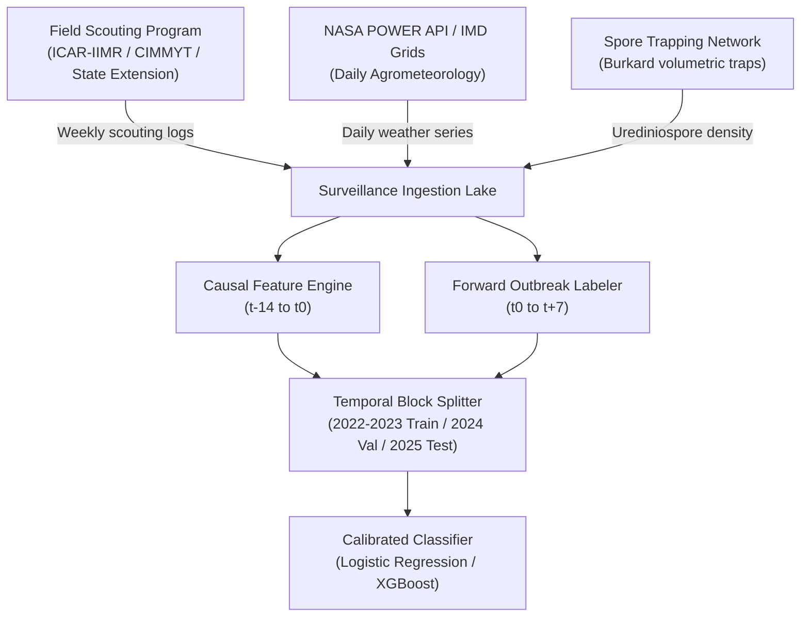

# AgriAdapt AI — 7-Day Maize Disease Outbreak Forecasting Pipeline Specification & Data Audit

**Project**: AgriAdapt AI / Pest & Crop Health MLOps  
**Date**: October 20, 2026  
**Status**: Data Audit Completed | Model Training Halted (Data Insufficient) | Pipeline Architecture & Data Contracts Deployed  

---

## 1. Objective Correction & Paradigm Shift

### The Corrected Mission
Agricultural disease management requires actionable foresight rather than retrospective confirmation.
- **Previous Component**: Instantaneous CNN classification of photographed maize leaves into disease categories (`blight`, `common_rust`, `gray_leaf_spot`, `healthy`). This informs the farmer of symptoms *already manifest* on a plucked leaf at date $t_0$.
- **Target Objective**: **Predict FUTURE disease outbreaks in maize fields 7 days in advance** ($[t_0 + 1, t_0 + 7]$) using antecedent microclimatic indicators, crop phenology, and epidemiological surveillance history.

This 7-day warning window enables proactive preventive interventions (e.g. bio-fungicides, canopy ventilation, irrigation scheduling, or targeted chemical sprays) before irreversible spore colonization and yield degradation occur.

---

## 2. Comprehensive Data Audit

A rigorous audit of all data assets, tabular records, image repositories, and API models in the workspace was conducted:

| Data Asset | Path / Source | Format & Size | Temporal Index? | Location Identifiers? | Disease / Outbreak Labels? | Suitability for 7-Day Forecasting |
| :--- | :--- | :--- | :---: | :---: | :---: | :--- |
| **Crop Recommendation Dataset** | `data/raw/Crop_recommendation.csv` | 2,200 rows × 8 cols (`N, P, K, temp, humidity, ph, rainfall, label`) | **NO** (Zero timestamps) | **NO** (No farm/GPS/district) | **NO** (Target is crop name to plant, e.g. `rice`, `maize`) | **UNSUITABLE** (Static soil/climate averages for planting advice) |
| **Maize Leaf Disease Image Dataset** | `data/maize_leaf_disease/` | 4,186 clean images across 4 folders (`blight`, `common_rust`, `gray_leaf_spot`, `healthy`) | **NO** (Zero timestamps) | **NO** (No geo-coordinates or field tracking) | Visual leaf symptoms only (`blight`, `common_rust`, `gray_leaf_spot`, `healthy`) | **UNSUITABLE AS OUTBREAK LABELS** (Cannot fabricate temporal outbreak dates or field dynamics from static photos) |
| **Bounding Box CSV Annotations** | `data/corn_maize_leaf_disease-main/corn_leaves/*/csv/*.csv` | 4,188 files (47 bytes each: `item,x,y,width,height,label`) | **NO** | **NO** | Bounding box spatial coordinates on image pixel canvas | **UNSUITABLE** (Computer vision spatial annotations only) |
| **Fertilizer Recommendation Dataset** | `models/fertilizer_model.joblib` | ICAR-IISS nutrient indices & state soil profiles | **NO** (Seasonal only: Kharif/Rabi) | State names only (district level absent) | **NO** (Targets are recommended N, P₂O₅, K₂O kg/ha) | **UNSUITABLE** (Soil fertility optimization only) |
| **Historical Disease Surveillance Records** | *Entire Project Repository* | **ABSENT** | **ABSENT** | **ABSENT** | **ABSENT** | **CRITICAL DEFICIT** (Zero field scouting logs, zero spore trap counts) |
| **Daily Weather & Sensor Time-Series** | *Entire Project Repository* | **ABSENT** | **ABSENT** | **ABSENT** | **ABSENT** | **CRITICAL DEFICIT** (Zero continuous daily weather series) |

---

## 3. The 7-Day Outbreak Forecasting Task Definition

### Core Specification
- **Target Crop**: Maize / Corn (*Zea mays*).
- **Primary Target Disease**: Common Rust (*Puccinia sorghi*).
- **Forecast Horizon**: **7 days** ($[t_0 + 1, t_0 + 7]$).
- **Prediction Unit**: A specific agricultural field / plot identifier at a specific calendar date ($t_0$).

### Target Formulation
$$\text{Target: } \text{"Will a NEW disease outbreak be observed in this field within the next 7 days?"}$$

### Critical Epidemiological Distinctions
To prevent data contamination, trivial self-correlation, and false alerting, the pipeline formally distinguishes three operational states:

1. **Disease Already Present at $t_0$**:
   - Symptoms observed during scouting at baseline ($t_0$) with incidence $> 0.5\%$ or severity $> 0\%$.
   - **Rule**: If a field already suffers from an active, uncontrolled outbreak at $t_0$ ($\text{severity} \ge 5\%$), it is categorized as a *chronic established infection* and assigned target label $Y = 0$. (Prevents the model from learning a trivial identity function).
2. **Newly Detected Disease at $t_0$**:
   - First appearance of trace pustules/lesions in the field in the current season ($0.5\% \le \text{incidence} < 2\%$).
   - Serves as an input feature (inoculum pressure) at $t_0$, **never as a future target label**.
3. **Future 7-Day Outbreak ($Y_{t+7} \in \{0, 1\}$)**:
   - Evaluated strictly over the forward window $[t_0 + 1, t_0 + 7]$.
   - $Y = 1$ if and only if:
     - Field transitions from sub-threshold ($\text{severity} < 5\%$) at $t_0$ to crossing the **Economic Injury Threshold** ($\text{severity} \ge 5\%$ on ear/canopy leaf area) within 7 days.
     - **OR** the field experiences an **explosive epidemic surge** ($\Delta \text{incidence} \ge +10\%$ infected plants) within 7 days.
   - $Y = 0$ otherwise.

---

## 4. Data Sufficiency Decision: Model Training Halted

> [!IMPORTANT]
> **Scientific Integrity & MLOps Decision**: Model training has been **strictly halted**.
> No machine learning forecasting model has been trained, and no synthetic outbreak metrics have been fabricated.

### Rationale
1. **Zero Temporal Outbreak Ground Truth**: The repository contains no time-indexed scouting records documenting disease incidence or severity over successive weeks.
2. **Static Images Cannot Represent Temporal Dynamics**: The 4,186 maize leaf photos in `data/maize_leaf_disease/` represent detached leaves photographed at a single moment. Using them to construct time-series forecasting labels would violate epidemiological physics and create a completely invalid model.
3. **Data Gating Enforced**: The pipeline's automated gate `InsufficientSurveillanceDataError` protects the codebase from training on inappropriate data.

---

## 5. Causal Feature Engineering Specification

The feature extractor strictly processes information known on or before date $t_0$ ($[t_0 - 13, t_0]$):

### A. Meteorological Features (Preceding 7 & 14 Days)
- `t7_mean_temp_c`, `t7_min_temp_c`, `t7_max_temp_c`: Thermal regime.
- `t7_temp_favorable_rust_hours_est`: Daily hours within the optimal *Puccinia sorghi* germination band ($16^\circ\text{C} - 25^\circ\text{C}$).
- `t7_mean_rh_pct`: Mean relative humidity.
- `t7_high_rh_days`: Number of days in preceding week with $\text{RH} \ge 80\%$.
- `t7_cumulative_rainfall_mm`, `t14_cumulative_rainfall_mm`: Short and medium-term moisture accumulation.
- `t7_estimated_leaf_wetness_hours_sum`: Estimated duration of free water film on leaf foliage (essential for urediniospore germ-tube penetration through stomata).

### B. Host Phenology & Vulnerability
- `growth_stage_vulnerability_index`: Phenological susceptibility score based on BBCH/CIMMYT scale (V5 whorl to R1 silking weighted at 0.65–1.00; dent/maturity weighted at 0.10–0.30).

### C. Historical Inoculum & Field Baseline
- `current_incidence_at_t0`: Percentage of infected plants observed at $t_0$.
- `current_severity_at_t0`: Percentage of leaf area diseased at $t_0$.
- `disease_already_present_t0`: Binary flag ($1$ if baseline symptoms exist, $0$ if pristine).
- `regional_outbreak_pressure_last_14d`: Proportion of neighboring scouted fields within the district experiencing active outbreaks over the past 14 days.

---

## 6. CNN Diagnostic Integration Blueprint

The existing MobileNetV2 image classification model (`models/maize_disease/maize_disease_model.keras`) is integrated via [src/models/maize_outbreak_forecasting/cnn_bridge.py](file:///d:/OMKAR/VITP/SEM%205/MLOPS/pest-outbreak-early-warning-mlops/src/models/maize_outbreak_forecasting/cnn_bridge.py).

### Integration Boundaries
1. **Current Leaf Diagnosis Only**: If an extension officer or farmer photographs a symptomatic leaf during scouting on date $t_0$, the CNN classifies current pustule morphology.
2. **Feature Input**: The predicted class probability $P(\text{common\_rust} \mid \text{leaf}_{t_0})$ enters the feature vector as an *instantaneous symptom prior* (`cnn_observed_leaf_rust_probability_t0`).
3. **Mandatory Scientific Warning**:
   > *"The CNN visual score reflects current symptom presence on an individual leaf sampled at $t_0$. It MUST NOT be interpreted as a 7-day future outbreak probability for the field."*

---

## 7. Required Historical Dataset & Collection Process

To genuinely train and deploy the forecasting model in Phase 2, the following multi-source surveillance pipeline must be connected:



### Exact Sourcing Partners:
1. **ICAR-IIMR (Indian Institute of Maize Research, Ludhiana/Hyderabad)**: All-India Coordinated Research Project on Maize (AICRP-Maize) disease trap nurseries and surveillance logs.
2. **CIMMYT India (Global Maize Program)**: Multi-environment trials tracking rust epidemiology across Karnataka, Bihar, and Telangana.
3. **State Agriculture Departments (CROPSAP Maharashtra / Karnataka K-GIS)**: District-level pest and disease surveillance records.
4. **NASA POWER Agroclimatology API**: Daily satellite and model weather ($T_{\min}, T_{\max}, \text{RH}, \text{Rainfall}, \text{Solar Radiation}$) queried by latitude/longitude for each monitored field.

---

## 8. Verification & Test Suite

The newly built forecasting module was validated with 9 automated tests:
```bash
pytest tests/test_maize_outbreak_forecasting.py -v
```
**Results: 9 passed in 6.26 seconds**:
1. `test_data_sufficiency_audit_detects_missing_longitudinal_records`: PASS
2. `test_outbreak_labeler_distinguishes_status_at_t0`: PASS
3. `test_outbreak_labeler_7day_forward_transition`: PASS
4. `test_outbreak_labeler_chronic_infection_not_counted_as_new_outbreak`: PASS
5. `test_outbreak_labeler_rejects_missing_forward_observations`: PASS
6. `test_temporal_feature_engineer_causality`: PASS
7. `test_pipeline_halts_training_without_surveillance_data`: PASS
8. `test_pipeline_forecast_screening_provides_disclaimer`: PASS
9. `test_cnn_bridge_features_and_disclaimer`: PASS
