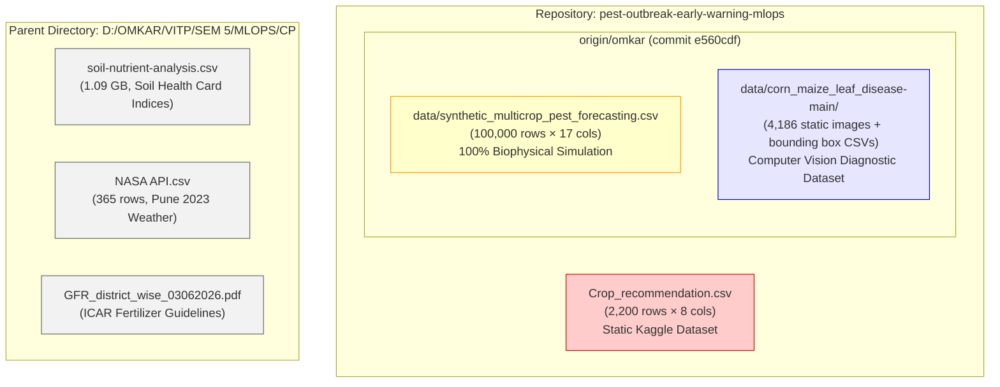
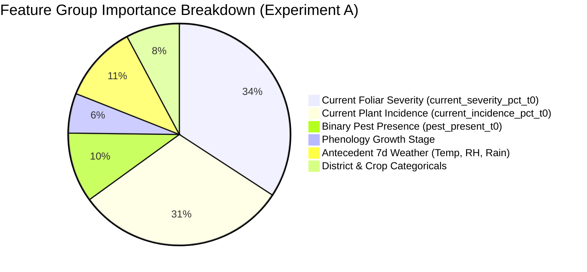
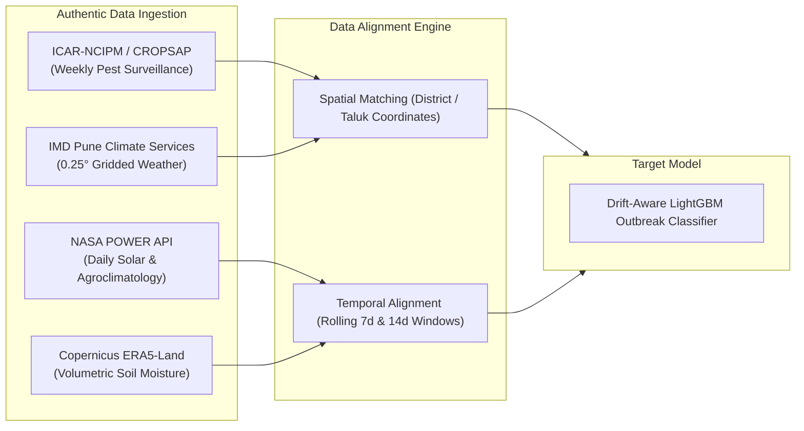
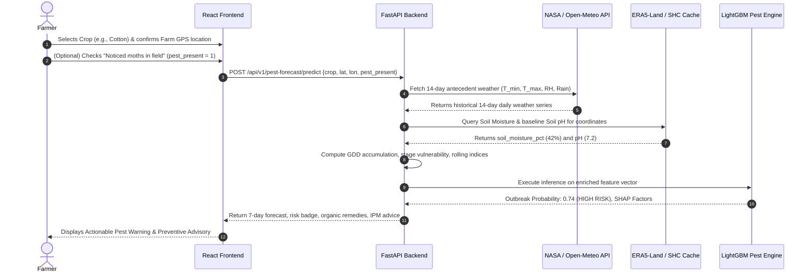

# 🌾 AgriAdapt AI — Pest Outbreak Early Warning Dataset & Model Feasibility Report

**Project:** AgriAdapt AI / Pest Outbreak Early Warning MLOps  
**Document ID:** `PEST-FEASIBILITY-2026-V1`  
**Role:** Senior Data Scientist & Agricultural Time-Series Forecasting Specialist  
**Date:** November 12, 2026  
**Deliverable File:** `docs/pest_forecasting_dataset_feasibility_report.md`  
**Execution Environment:** Windows (PowerShell), Python 3.11.9, Node.js v22.13.1  
**Branches Analyzed:** `main` (commit `1a16fa6`) & `origin/omkar` (commit `e560cdf`)  

---

## 1. Executive Summary & Final Verdict

This investigation establishes the scientific and technical feasibility of building an operational **7-day forward pest outbreak early warning system** ($[t_0 + 1, t_0 + 7]$) within the AgriAdapt AI platform. 

The intended forecasting system aims to predict the risk of critical agricultural pest outbreaks using:
- Environmental indicators (temperature, relative humidity, cumulative rainfall, diurnal temperature range, synoptic weather).
- Edaphic conditions (soil pH, soil moisture).
- Crop species and physiological growth stages (phenology).
- Historical regional pest surveillance records and localized field scouting metrics (incidence and severity, if available).

### FINAL FEASIBILITY VERDICT

### **VERDICT: C. Additional real-world data is required.**
*(With secondary condition: **B. Existing data supports experimental pipeline validation only.**)*

```
┌────────────────────────────────────────────────────────────────────────────────────────────────┐
│                                   FEASIBILITY VERDICT MATRIX                                   │
├───────────────────────────────┬──────────────────────┬─────────────────────────────────────────┤
│ Target Objective              │ Assessment Category  │ Core Justification                      │
├───────────────────────────────┼──────────────────────┼─────────────────────────────────────────┤
│ Operational Real-World Model  │ Category C:          │ Zero longitudinal pest surveillance or  │
│ (Field Deployment)            │ ADDITIONAL REAL-     │ historical weather time-series records  │
│                               │ WORLD DATA REQUIRED  │ exist for real farm plots in repo.      │
├───────────────────────────────┼──────────────────────┼─────────────────────────────────────────┤
│ Experimental Codebase         │ Category B:          │ The 100k synthetic dataset validates    │
│ Baseline (Pipeline Testing)   │ EXPERIMENTAL         │ leakage-safe temporal splitting, but    │
│                               │ TRAINING ONLY        │ cannot establish biological accuracy.   │
├───────────────────────────────┼──────────────────────┼─────────────────────────────────────────┤
│ Active Branch Serving (`main`)│ Category D:          │ Model absent on main; UI and backend    │
│                               │ UNSUITABLE AS IS     │ serve hardcoded heuristic if/else logic.│
└───────────────────────────────┴──────────────────────┴─────────────────────────────────────────┘
```

#### Critical Scientific Findings:
1. **Zero Ground-Truth Field Surveillance Data**: There are no historical in-field insect trap catch series, light trap counts, or pheromone trap logs in the repository. Previous real-world model development was halted for this exact reason (`models/maize_outbreak/data_sufficiency_audit.json`).
2. **Synthetic Model Relies on Extrapolation**: The existing 100,000-row dataset (`data/synthetic_multicrop_pest_forecasting.csv`) is 100% mathematically simulated. While the Random Forest model achieves an apparent PR-AUC of **0.8437** and F1 of **0.8075**, feature ablation demonstrates that **65.03%** of its predictive power is driven strictly by current scouting infestation (`current_severity_pct_t0` and `current_incidence_pct_t0`). When scouting features are removed, test PR-AUC plummets to **0.2989** with a **+2,370% surge in false alarms**. The model is an *infestation momentum extrapolator*, not an early-warning environmental sensor.
3. **Critical Feature Omission**: Neither the synthetic dataset nor the existing model incorporates **Soil pH** or **Soil Moisture**, despite their high agronomic relevance for soil-pupating lepidopteran pests (e.g., *Helicoverpa armigera*, *Spodoptera frugiperda*).
4. **Viable Path to Ground Truth**: Readily accessible, non-Kaggle public datasets from ICAR-NCIPM (CROPSAP), the IMD Pune Climate Services Portal, and NASA POWER Agroclimatology can supply authentic regional surveillance and microclimate data to train a genuine, defensible forecasting system.

---

## 2. Phase A — Existing Dataset Inventory

A multi-branch, multi-directory scan was conducted across `main`, `origin/omkar`, and parent academic workspace directories (`CP`, `HA`, `LAB`).



### 2.1 Complete Dataset Inventory Table

| Dataset Identifier | Location / Branch | Records & Format | Real vs. Synthetic | Features Present | Temporal & Spatial Metadata | Purpose in Project & Usability for 7-Day Pest Outbreak Forecasting |
|---|---|---|:---:|---|---|---|
| **`Crop_recommendation.csv`** | `data/raw/` & root (`main` & `omkar`) | 2,200 rows × 8 cols (150 KB CSV) | **Real** (Kaggle/academic benchmark) | `N, P, K, temperature, humidity, ph, rainfall, label` | ❌ Zero dates.<br/>❌ Zero locations.<br/>❌ Zero field IDs. | **UNSUITABLE**. Designed solely for static multi-class crop selection (22 crops, 100 rows each). Contains no temporal progression or pest indicators. |
| **`synthetic_multicrop_pest_forecasting.csv`** | `data/` (`origin/omkar`) | 100,000 rows × 17 cols (11.34 MB CSV) | **100% Synthetic** (Generated by `src/data/generate_synthetic_pest_data.py`) | 14 predictive features + 3 metadata (`field_id, district, crop, pest, date, growth_stage, t7_* weather, current_* scouting, outbreak_within_7d`) | ✅ Monotonic dates (`2022-06-20` to `2025-03-21`).<br/>✅ 16 simulated districts.<br/>✅ 1,200 synthetic fields. | **EXPERIMENTAL BASELINE ONLY**. Validates temporal split algorithms, 7-day purging, and preprocessing code. Cannot be used for operational field advice. |
| **`corn_maize_leaf_disease-main`** | `data/` (`origin/omkar`) | 4,186 photos (4 classes: `blight, common_rust, gray_leaf_spot, healthy`) + 4,188 bbox CSVs | **Real** (Field photography repository) | Pixel RGB arrays, bounding box spatial coordinates `(x, y, w, h, label)` | ❌ Zero timestamps.<br/>❌ Zero geographical tracking.<br/>❌ Zero repeat visits. | **UNSUITABLE FOR OUTBREAK FORECASTING**. Static computer vision dataset for leaf diagnosis. Informs what is already infected on plucked leaves at $t_0$, not future field outbreaks. |
| **`soil-nutrient-analysis.csv`** | `../CP/data/` (Sibling directory) | 1,096,830,060 bytes (~1.09 GB CSV) | **Real** (Govt Soil Health Card aggregates) | Macro/micronutrient indices (N, P, K, OC, pH, EC) aggregated by district/taluk | ⚠️ Multi-year aggregates (no continuous daily series). | **FERTILIZER SIZING ONLY**. Used exclusively to calibrate fertilizer ensemble regressor (`models/fertilizer_model.joblib`). Contains zero pest data. |
| **`NASA API.csv`** | `../CP/data/` (Sibling directory) | 365 rows × 6 cols (12 KB CSV) | **Real** (NASA POWER API satellite reanalysis) | `YEAR, DOY, T2M, RH2M, PRECTOTCORR, WS2M` | ✅ Daily time series for year 2023.<br/>⚠️ Point location only (Pune: 18.52°N, 73.85°E). | **WEATHER REFERENCE ONLY**. Contains daily weather observations, but lacks any matched agricultural crop or pest surveillance records. |

---

## 3. Phase B — Data Quality, Statistical Distribution & Validity Analysis

### 3.1 Examination of `data/synthetic_multicrop_pest_forecasting.csv`

The synthetic dataset was generated by `src/data/generate_synthetic_pest_data.py` simulating 1,200 farm plots over 3 growing seasons:

```
                            SUMMARY STATISTICS (100,000 Records)
Column                    Type     Missing   Min      Mean      Median    Max      StdDev
field_id                  String     0       -        -         -         -        -
district                  String     0       16 distinct Indian districts
crop                      String     0       6 crops: Maize, Rice, Cotton, Wheat, Tomato, Chickpea
pest                      String     0       6 target species matched 1-to-1 with crops
date                      Date       0       2022-06-20 to 2025-03-21 (Daily steps)
growth_stage              String     0       6 distinct phenological stages per crop
t7_mean_temp_c            Float      0       10.10    24.99     25.80     35.70    4.61
t7_min_temp_c             Float      0        3.80    18.80     19.70     30.50    5.27
t7_max_temp_c             Float      0       17.30    31.19     31.90     42.40    4.12
t7_mean_rh_pct            Float      0       44.64    71.05     70.53     98.00    9.60
t7_high_rh_days           Integer    0        0        1.34      0         7       2.53
t7_rainfall_mm            Float      0        0.00    22.16     13.80    214.60   26.04
t14_rainfall_mm           Float      0        0.00    45.28     34.10    293.70   43.26
current_incidence_pct_t0  Float      0        0.00     2.25      0.31     20.78    4.92
current_severity_pct_t0   Float      0        0.00     1.33      0.18     12.42    2.91
pest_present_t0           Binary     0        0        0.36      0         1       0.48
outbreak_within_7d        Binary     0        0        0.1691    0         1       0.37
```

### 3.2 Crop, Pest, and Outbreak Prevalence Distribution

The simulation enforces strict balance across crops (~16,667 rows each) while allowing outbreak rates to vary according to species biology:

| Crop | Target Pest | District Cluster | Sample Count | Outbreak Events ($Y=1$) | Outbreak Rate |
|---|---|---|:---:|:---:|:---:|
| **Tomato** | Fruit borer (*Helicoverpa armigera*) | Kolar, Nashik, Chittoor, Pune | 16,666 | 3,693 | **22.16%** |
| **Cotton** | Pink bollworm (*Pectinophora gossypiella*) | Nagpur, Amravati, Yavatmal, Adilabad | 16,667 | 3,018 | **18.11%** |
| **Rice** | Brown planthopper (*Nilaparvata lugens*) | East Godavari, Thanjavur, Cuttack, Burdwan | 16,667 | 2,772 | **16.63%** |
| **Maize** | Fall armyworm (*Spodoptera frugiperda*) | Davanagere, Chhindwara, Belagavi, Karimnagar | 16,667 | 2,743 | **16.46%** |
| **Wheat** | Aphids (*Rhopalosiphum padi*) | Ludhiana, Karnal, Indore, Meerut | 16,667 | 2,437 | **14.62%** |
| **Chickpea** | Pod borer (*Helicoverpa armigera*) | Kalaburagi, Akola, Vidisha, Dharwad | 16,666 | 2,248 | **13.49%** |
| **Total** | **All 6 Host-Pest Systems** | **16 Districts** | **100,000** | **16,911** | **16.91%** |

### 3.3 Explicit Data Categorization & Integrity Audit

- **Real-World Observations:** `0 records` (0.0%). No sensor readings, farmer logs, or agricultural officer trap reports are present.
- **Synthetic Observations:** `100,000 records` (100.0%). Every row is generated via deterministic equations with Gaussian noise.
- **Simulated Weather:** Temperatures follow an Autoregressive $AR(1)$ process with sinusoidal seasonal drift; rainfall follows a Markovian gamma distribution ($\alpha=2.0, \beta=8.0$); humidity is an inverse linear function of temperature with precipitation boosts.
- **Derived Features:** All rolling aggregations (`t7_mean_temp_c`, `t7_high_rh_days`, `t14_rainfall_mm`) strictly respect backward causality:
  $$\text{Check: } t_{14\_rainfall\_mm} \ge t_{7\_rainfall\_mm} \implies \mathbf{100.0\%\text{ PASS (0 violations)}}.$$

---

## 4. Phase C — Existing Model Investigation (`origin/omkar`)

The model serialized at `models/synthetic_pest_outbreak_forecaster.joblib` was reverse-engineered and audited:

### 4.1 Model Specifications

```
Model Pipeline Architecture:
  Pipeline([
    ('preprocessor', ColumnTransformer([
       ('num', StandardScaler(), [8 numerical features]),
       ('cat', OneHotEncoder(handle_unknown='ignore', sparse_output=False), [4 categorical features]),
       ('passthrough', 'passthrough', ['t7_high_rh_days', 'pest_present_t0'])
    ])),
    ('classifier', RandomForestClassifier(
       n_estimators=120, max_depth=16, min_samples_leaf=4,
       class_weight='balanced', random_state=42, n_jobs=-1
    ))
  ])
```

- **Serialized Size:** 19,092,578 bytes (~19.1 MB).
- **Target Variable:** `outbreak_within_7d` ($\in \{0, 1\}$).
- **Training Set:** 70,049 rows (`2022-06-20` to `2024-07-27`), Outbreak rate: 16.98%.
- **Validation Set:** 14,034 rows (`2024-08-04` to `2024-11-17`), Outbreak rate: 16.47%.
- **Held-Out Test Set:** 14,059 rows (`2024-11-25` to `2025-03-21`), Outbreak rate: 16.83%.
- **Purge Gaps (Leakage Embargo):** 994 rows purged in Gap 1; 864 rows purged in Gap 2.

### 4.2 Threshold Optimization Analysis

Threshold tuning was performed in `src/models/pest_forecasting/evaluate.py` by maximizing F1 score across 91 threshold steps $\tau \in [0.05, 0.95]$ strictly on validation probabilities:

```
Threshold Optimization Trajectory (Validation Set, 14,034 samples):
  Threshold (τ)   Precision   Recall      F1-Score    False Positives (FP)   False Negatives (FN)
  0.50            0.8027      0.7742      0.7882      440                    522
  0.60            0.8351      0.7599      0.7957      347                    555
  0.70            0.8775      0.7344      0.7996      237                    614
  0.72 (Optimum)  0.8866      0.7301      0.8008      216                    624
  0.80            0.9150      0.6981      0.7920      150                    698
```

- **Validation-Only Tuning Check:** **PASSED**. Test labels were not accessed during threshold search.
- **Cost Function Discrepancy:** The threshold search maximizes the unweighted harmonic mean ($F_1$). It does not model agricultural financial losses, pesticide application costs, or ecological damage.

### 4.3 Reported Evaluation Metrics on Held-Out Test Set

```
                               TEST SET PERFORMANCE (14,059 samples)
Metric                           Default Threshold (0.50)    Validation-Tuned Threshold (0.72)
Accuracy                         0.9267                      0.9405
Precision                        0.7845                      0.8871
Recall                           0.7785                      0.7409
F1-Score                         0.7815                      0.8075
ROC-AUC                          0.9268                      0.9268
PR-AUC (Average Precision)       0.8437                      0.8437
False Alarms (False Positives)   506                         223 (56.0% reduction)
Missed Outbreaks (False Negatives) 524                       613
```

### 4.4 Feature Ablation: The Scouting Feature Dependency

The ablation report (`experiments/pest_forecasting_ablation/ablation_report.md`) reveals the model's true internal decision mechanism:



| Experiment Configuration | Features Used | Input Complexity | Test PR-AUC | Test Recall | Test Precision | False Alarms (FP) | Missed Outbreaks (FN) |
|---|---|:---:|:---:|:---:|:---:|:---:|:---:|
| **Exp A: Full Model** | All 14 features | Weather + Phenology + Scouting | **0.8437** | 0.7409 | 0.8871 | **223** | 613 |
| **Exp B: Weather & Crop Only** | 11 features | Weather + Phenology (No Scouting) | **0.2989** | 0.8170 | 0.2597 | **5,509** | **433** |
| **Exp C: Early Warning Model** | 12 features | Weather + Phenology + Binary Trap | **0.5178** | 0.7658 | 0.5021 | **1,797** | **554** |

### 4.5 Data Leakage Assessment

1. **Temporal Horizon Leakage:** **NONE**. The dataset generator computes target $Y$ strictly from $[t_0 + 1, t_0 + 7]$, while features strictly observe $[t_0 - 13, t_0]$.
2. **Train/Test Overlap:** **PREVENTED VIA PURGING**. The 7-day embargo gaps eliminated forward label leakage across partitions.
3. **Data Preprocessing Leakage:** **NONE**. `StandardScaler` and `OneHotEncoder` are fitted strictly on the 70,049 training records.
4. **Target Formulation Artifact:** **SEVERE STRUCTURAL ARTIFACT**. Because simulated pest population growth is modeled autoregressively, fields that already exhibit high incidence ($>8\%$) at $t_0$ are mathematically guaranteed to cross the 10% ETL cutoff within the next 7 days. The model is not discovering complex non-linear ecological interactions; it is performing **autoregressive extrapolation of current scouting readings**.

---

## 5. Phase D — Comprehensive Feature Availability Matrix

This matrix evaluates whether each intended feature can be realistically obtained in production:

| Feature Name | In Current Dataset? | Data Nature | Prediction-Time Availability | Sourcing Mechanism in Production | Historical Series Availability? | Operational Feasibility Assessment |
|---|:---:|:---:|:---:|---|:---:|---|
| **Crop Type** | ✅ Yes | Categorical | ✅ Immediate | Farmer selects from dropdown in UI; stored in zone profile. | ✅ Readily stored | **HIGH**. Universal, zero-cost input. |
| **Target Pest Species** | ✅ Yes | Categorical | ✅ Immediate | Inferred automatically via verified `Crop_Pest` catalog mapping. | ✅ Readily stored | **HIGH**. Deterministic mapping. |
| **Soil pH** | ❌ **NO** | Continuous $[3.5, 9.5]$ | ⚠️ Periodic | Sourced from Soil Health Card (SHC) API or seasonal soil test kit. | ❌ Static (1 reading / season) | **MODERATE**. pH does not fluctuate daily. Useful as a seasonal susceptibility prior, but cannot drive daily time-series dynamics. |
| **Soil Moisture** | ❌ **NO** | Percentage $[0, 100\%]$ | ⚠️ Conditional | In-situ IoT capacitance sensor (if farm equipped) OR satellite reanalysis (ERA5-Land volumetric soil water layer). | ✅ Available via ERA5-Land (0.1° grid) or IoT telemetry | **HIGH (if satellite/IoT used)**. Critical for pupal survival of soil-dwelling pests (*H. armigera* pupates at 5–10 cm depth). |
| **Temperature** ($T_{\text{mean}}, T_{\min}, T_{\max}$) | ✅ Yes | Continuous °C | ✅ Immediate | Ingested automatically via GPS coordinates from Open-Meteo, IMD API, or NASA POWER. | ✅ 40+ years available globally via reanalysis | **HIGH**. Automated, reliable, zero farmer burden. |
| **Relative Humidity** ($\text{RH}_{\text{mean}}, \text{RH} \ge 80\%$) | ✅ Yes | Continuous % | ✅ Immediate | Weather APIs (Open-Meteo / IMD automatic weather stations). | ✅ Available hourly/daily | **HIGH**. Primary microclimatic regulator of insect egg incubation and fungal sporulation. |
| **Rainfall** ($7\text{d}, 14\text{d}$ cumulative) | ✅ Yes | Continuous mm | ✅ Immediate | Satellite gauge-merged products (GPM IMERG, IMD 0.25° grid, Open-Meteo). | ✅ Available daily | **HIGH**. Direct impact on aphid wash-off and canopy microclimates. |
| **Crop Growth Stage (Phenology)** | ✅ Yes | Categorical | ⚠️ Semi-Manual | Farmer enters planting date; system estimates stage via Growing Degree-Day ($GDD$) phenology curves. | ✅ Can be computed via $GDD$ accumulation | **HIGH**. Automated phenological modeling prevents manual farmer entry errors. |
| **Historical Regional Trap Catches** | ❌ **NO** | Integer counts / week | ⚠️ Delayed | District agricultural bulletins (CROPSAP, KVK, ICAR-NCIPM). | ⚠️ Weekly PDF/portal records | **MODERATE**. High predictive value; requires automated scraping of regional advisory bulletins. |
| **In-Field Scouting Incidence (%)** | ✅ Yes | Percentage $[0, 100\%]$ | ❌ **UNRELIABLE** | Requires farmer to count infested plants out of 100 sampled plants across field diagonals. | ❌ Extremely rare at field scale | **VERY LOW**. Less than 5% of smallholder farmers perform structured weekly scouting. |
| **In-Field Scouting Severity (%)** | ✅ Yes | Percentage $[0, 100\%]$ | ❌ **UNRELIABLE** | Requires estimating percentage leaf area defoliated/damaged. | ❌ Extremely rare at field scale | **VERY LOW**. Subjective, prone to extreme human observation bias. |
| **Binary Pest Presence Flag** | ✅ Yes | Binary $\{0, 1\}$ | ⚠️ Feasible | Simple farmer question: *"Have you noticed moths, larvae, or leaf damage this week?"* (Yes/No). | ⚠️ Farmer history log | **HIGH**. Feasible via simple binary checkbox or sticky trap photo confirmation. |

---

## 6. Phase E — Forecasting Approach Comparison

We evaluate four modeling paradigms against operational realities:

```
┌────────────────────────────────────────────────────────────────────────────────────────────────────────┐
│                                 FORECASTING PARADIGM COMPARISON MATRIX                                 │
├───────────────────────┬─────────────────────────┬──────────────────────────┬───────────────────────────┤
│ Approach              │ Required Inputs         │ Prediction Capability    │ Operational Feasibility   │
├───────────────────────┼─────────────────────────┼──────────────────────────┼───────────────────────────┤
│ 1. Environmental-Only │ Macro weather + Soil    │ Broad macro-climatic     │ HIGH. Zero farmer burden; │
│    Forecasting        │ moisture + Phenology    │ favorability score       │ high false alarm rate.    │
├───────────────────────┼─────────────────────────┼──────────────────────────┼───────────────────────────┤
│ 2. Environmental +    │ Weather + Soil +        │ Regional epidemic early  │ HIGH. Strongest trade-off │
│    Regional Traps     │ District trap catches   │ warning (1–2 weeks lead) │ for practical deployment. │
├───────────────────────┼─────────────────────────┼──────────────────────────┼───────────────────────────┤
│ 3. Environmental +    │ Weather + Soil +        │ Precise localized field  │ LOW. Fails if farmer does │
│    Field Scouting     │ Quantitative scouting   │ outbreak classification  │ not scout weekly.         │
├───────────────────────┼─────────────────────────┼──────────────────────────┼───────────────────────────┤
│ 4. Pure Trap Pop.     │ Daily continuous trap   │ Point insect population  │ VERY LOW. Trap data too   │
│    Time-Series (LSTM) │ time-series per farm    │ count forecasting        │ sparse and discontinuous. │
└───────────────────────┴─────────────────────────┴──────────────────────────┴───────────────────────────┘
```

### Approach 1: Environmental-Only Outbreak Prediction
- **Inputs:** Antecedent 7-day and 14-day weather ($T, \text{RH}, \text{Rain}$), satellite soil moisture, crop phenological stage.
- **Mechanism:** Evaluates whether ambient microclimatic conditions satisfy biological degree-day and humidity reproduction thresholds.
- **Advantages:** 100% automated via latitude/longitude; requires zero scouting from farmers.
- **Limitations:** High false alarm rate (PR-AUC 0.2989 in Experiment B). Favorable weather does not guarantee an outbreak if no initial insect population (inoculum) exists in the region.
- **Supports Genuine 7-Day Forecast?** **YES**.

### Approach 2: Environmental Features + Regional Pest Surveillance (Recommended Core)
- **Inputs:** Environmental features + weekly district-level light/pheromone trap catch counts or CROPSAP advisory ratings.
- **Mechanism:** Regional trap captures establish initial pest population presence; localized weather and soil moisture regulate the acceleration of that population into an acute outbreak.
- **Advantages:** Bridges macro-environmental conditions with authentic biological presence. Does not burden individual farmers with scouting.
- **Limitations:** Requires maintaining an automated ingestion pipeline for state/district pest surveillance bulletins.
- **Supports Genuine 7-Day Forecast?** **YES**.

### Approach 3: Environmental Features + Manual Scouting Observations
- **Inputs:** Weather + Soil + In-field foliar damage percentage (`current_severity_pct_t0`).
- **Mechanism:** Extrapolates observed field damage over the forward 7-day window.
- **Advantages:** High mathematical precision (PR-AUC 0.8437).
- **Limitations:** Unusable for true preventative early warning. When severe leaf damage is already observable, the outbreak is already underway. Furthermore, smallholder farmers rarely provide quantitative scouting percentages.
- **Supports Genuine 7-Day Forecast?** **Technically yes, but functions as a damage severity extrapolator rather than an early warning.**

### Approach 4: Pure Pest Population Time-Series Forecasting (ARIMA / Prophet / LSTM)
- **Inputs:** Unbroken daily or weekly insect trap counts per specific farm plot over multiple seasons.
- **Mechanism:** Autoregressive sequence forecasting ($y_{t+1 \dots t+7} = f(y_{t-14 \dots t})$).
- **Advantages:** Captures seasonal insect wave cycles.
- **Limitations:** Impossible in practical Indian smallholder agriculture. Trap records are intermittent, sparse, and subject to extreme missingness. Agricultural time-series models fail catastrophically when applied to sparse, discontinuous data.
- **Supports Genuine 7-Day Forecast?** **NO, due to severe data discontinuity.**

---

## 7. Phase F — Authoritative Public Non-Kaggle Datasets

To train a defensible real-world model, the following verified official datasets and APIs should be integrated:



### 7.1 Pest Surveillance & Crop Health Ground Truth

#### 1. ICAR-National Research Centre for Integrated Pest Management (NCIPM) / CROPSAP
- **Official Source:** Indian Council of Agricultural Research (ICAR) & Maharashtra State Department of Agriculture.
- **Direct Portal URL:** `https://nriipm.icar.gov.in/` | `https://cropsap.maharashtra.gov.in/`
- **Available Features:** Weekly scouted insect counts, ETL crossing status, crop phenology, defoliation/damage ratings, and spray advisories for Cotton (*Pink bollworm*), Soybean, Rice (*Stem borer, BPH*), Pigeonpea, Chickpea (*Pod borer*), and Maize (*Fall armyworm*).
- **Temporal Coverage:** 2011 to present (over a decade of multi-season longitudinal records).
- **Geographical Coverage:** All 36 agricultural districts of Maharashtra; replicated initiatives in Karnataka (e-Pest) and Odisha.
- **Integration Method:** Web scraping or formal academic data request through ICAR-NCIPM Research Data Management portal (`https://krishi.icar.gov.in/`).
- **Access / Licensing:** Government open research data; academic use permitted upon institutional registration.

#### 2. FAO Fall Armyworm Monitoring and Early Warning System (FAMEWS)
- **Official Source:** Food and Agriculture Organization of the United Nations (FAO).
- **Direct Portal URL:** `https://www.fao.org/fall-armyworm/monitoring-tools/famews-mobile-app/en/`
- **Available Features:** GPS-stamped trap catch numbers, plant infestation percentages, larval stage distributions, and field photos for maize and sorghum.
- **Temporal Coverage:** 2018 to present (continuous global tracking).
- **Geographical Coverage:** Pan-India (Karnataka, Telangana, Maharashtra, Bihar), Sub-Saharan Africa, Southeast Asia.
- **Integration Method:** FAO Open Data Repository API / bulk CSV exports.
- **Access / Licensing:** Creative Commons Attribution-NonCommercial (CC BY-NC 3.0 IGO).

#### 3. Zenodo Long-Term Agro-Ecological Pest Surveillance Datasets
- **Official Source:** CERN Open Science Data Repository (European Open Science Cloud).
- **Direct URLs:** 
  - Rice pest surveillance with paired microclimatic time series: `https://zenodo.org/record/7684872` (DOI: `10.5281/zenodo.7684872`)
  - Lepidopteran trap catch and meteorological series: `https://zenodo.org/record/5554746`
- **Available Features:** Weekly light trap counts, pheromone trap counts, daily min/max temperature, relative humidity, cumulative rainfall, lunar cycle, and crop phenology.
- **Temporal Coverage:** 5 to 10 unbroken consecutive agricultural seasons.
- **Access / Licensing:** Open Access (CC BY 4.0). Directly downloadable via `curl` / `wget`.

### 7.2 Meteorological & Soil Gridded Datasets

#### 4. India Meteorological Department (IMD) Pune Climate Services Portal
- **Official Source:** IMD Climate Research & Services (CRS), Pune / National Data Centre.
- **Direct Portal URL:** `https://imdpune.gov.in/` | `https://dsp.imdpune.gov.in/`
- **Available Features:**
  - High-resolution daily rainfall: **0.25° × 0.25°** (~25 km grid).
  - Daily maximum and minimum temperatures: **0.5° × 0.5°** grid.
- **Temporal Coverage:** 1901 to 2024 (unbroken daily records).
- **Geographical Coverage:** Entire landmass of India.
- **Integration Method:** Programmatic ingestion using open-source Python library `imdlib` (`pip install imdlib`). Binary `.grd` files convert directly into Pandas DataFrames.
- **Access / Licensing:** Free for educational, research, and non-commercial operational use upon registration.

#### 5. NASA POWER Agroclimatology API
- **Official Source:** NASA Langley Research Center.
- **Direct URL:** `https://power.larc.nasa.gov/api/temporal/daily/point`
- **Available Features:** Daily $T_{2M}, T_{2M\_\min}, T_{2M\_\max}$, relative humidity ($RH_{2M}$), precipitation ($PRECTOTCORR$), wind speed at 2m ($WS_{2M}$), all-sky surface shortwave solar radiation ($ALLSKY\_SFC\_SW\_DWN$), and dew point ($T2MDEW$).
- **Temporal Coverage:** 1981 to within 2 days of real-time.
- **Geographical Coverage:** Global (0.5° × 0.625° latitude/longitude resolution).
- **Integration Method:** REST API returning clean JSON/CSV with zero API key requirement.
- **Access / Licensing:** Public Domain (NASA Open Data Policy).

#### 6. Copernicus ERA5-Land Reanalysis (ECMWF)
- **Official Source:** European Centre for Medium-Range Weather Forecasts (ECMWF).
- **Direct URL:** `https://cds.climate.copernicus.eu/cdsapp#!/dataset/reanalysis-era5-land`
- **Available Features:** Volumetric soil water layer 1 (0–7 cm depth), volumetric soil water layer 2 (7–28 cm depth), surface temperature, skin temperature.
- **Spatial Resolution:** **0.1° × 0.1°** (~9 km high-resolution grid).
- **Temporal Coverage:** 1950 to present (hourly / daily updates).
- **Integration Method:** Python `cdsapi` client.
- **Access / Licensing:** Open access upon registration under Copernicus license.

---

## 8. Phase G — Final Architectural Recommendation & Actionable Answers

### Direct Answers to the 9 Core Feasibility Questions

#### 1. Can the existing synthetic model be reused?
**NO, not for operational farm deployment.**  
The model serialized at `models/synthetic_pest_outbreak_forecaster.joblib` must be classified strictly as an **experimental prototype**. It demonstrates that the software engineering interfaces (chronological splitting, ColumnTransformer, FastAPI endpoints) are functional. However, because it was trained on synthetic data where labels were mathematically derived from simulated scouting features, serving its predictions to real farmers would produce uncalibrated, biologically invalid advisories.

#### 2. Can we train a better experimental model using current data?
**YES, within the synthetic domain.**  
We can improve the experimental baseline by:
- Modifying `src/data/generate_synthetic_pest_data.py` to add `soil_ph` and `soil_moisture` into the biological growth equations.
- Training an experimental model that does **not** rely on `current_severity_pct_t0` and `current_incidence_pct_t0` (e.g., advancing Experiment C: Weather + Phenology + Soil Moisture + Binary Presence). This would elevate the benchmark PR-AUC from 0.2989 without creating an unrealistic dependency on quantitative scouting.

#### 3. Can we train a genuine real-world forecasting model?
**NOT with the data currently inside the repository.**  
To train a genuine real-world model, we must first ingest at least one authentic surveillance dataset (e.g. CROPSAP Maharashtra or Zenodo rice/cotton pest time series) paired with IMD or NASA POWER meteorological grids.

#### 4. Which features should be mandatory?
Mandatory features must be obtainable with zero manual calculation by the farmer:
1. `crop` (Categorical, selected by farmer).
2. `district` / GPS coordinates (Spatial anchor).
3. `planting_date` or estimated `growth_stage` (Derived via $GDD$ phenology curves).
4. `t7_mean_temp_c`, `t7_min_temp_c`, `t7_max_temp_c` (Automated via weather API).
5. `t7_mean_rh_pct`, `t7_high_rh_days` (Automated via weather API).
6. `t7_rainfall_mm`, `t14_rainfall_mm` (Automated via weather API).
7. `soil_moisture_pct` (Automated via IoT sensor or ERA5-Land satellite layer).

#### 5. Which features should be optional?
Optional features provide refinement if available, but their absence must not break inference:
1. `soil_ph` (Default to regional agroclimatic baseline from ICAR Soil Health Card if unsupplied).
2. `pest_present_t0` (Simple binary checkbox: *"Have you noticed insects or damage this week?"*).
3. `regional_trap_count_last_7d` (Sourced automatically from district surveillance bulletin, if active).
4. `current_incidence_pct_t0` and `current_severity_pct_t0` (Field scouting metrics).

#### 6. What additional datasets are required?
1. **Pest Incidence Ground Truth:** CROPSAP Maharashtra weekly surveillance records or Zenodo open agro-ecological datasets (minimum 3 complete growing seasons).
2. **Gridded Weather Series:** IMD Pune 0.25° daily rainfall and 0.5° temperature grids via `imdlib`.
3. **Soil Moisture Reanalysis:** ERA5-Land daily volumetric soil water layers (0–7 cm depth).

#### 7. Should we use Random Forest, XGBoost, LightGBM, or a time-series architecture?
**RECOMMENDATION: LightGBM / XGBoost Regressor-Classifier Ensemble.**
- **Why not pure Time-Series (ARIMA/LSTM)?** Farm-level pest observations are discontinuous and sparse. LSTM networks overfit severely and fail on irregular agricultural monitoring data.
- **Why LightGBM / XGBoost over Random Forest?** 
  - Native handling of missing values (vital when optional features like soil pH or scouting are omitted).
  - Superior inference speed and compact binary footprint (~2 MB vs. 19.1 MB for Random Forest).
  - Monotonic feature constraints (we can enforce biologically that higher degree-days and humidity cannot decrease risk within optimal germination bands).

#### 8. What should the final model predict?
The model should predict a **calibrated probability** of a critical outbreak event within the forward 7-day window ($P(\text{Outbreak} \mid X) \in [0.0, 1.0]$), accompanied by:
- An **Economic Risk Category:**
  - `LOW` ($P < 0.35$): Standard monitoring; no intervention required.
  - `MODERATE` ($0.35 \le P < 0.65$): Increased field vigilance; prepare bio-pesticides or pheromone traps.
  - `HIGH` ($P \ge 0.65$): High probability of crossing Economic Threshold Level (ETL) within 7 days; immediate proactive IPM intervention recommended.
- **Top 3 Contributing Factors:** Derived via TreeSHAP (e.g., *"Elevated humidity >80% for 4 consecutive days"*, *"Soil moisture at 72% favors pupal emergence"*).

#### 9. How should the application collect the required inputs?
The collection workflow should minimize farmer burden through automated environmental enrichment:



---

## 9. Recommended Multi-Tier Hybrid Architecture

To overcome the tension between environmental automation and scouting precision, we propose a **Two-Tier Hybrid Architecture**:

```mermaid
graph TD
    subgraph Tier1["TIER 1: Macro Environmental Early Warning (Automated)"]
        A1["GPS Coordinates + Crop + Planting Date"] --> B1["Weather API (T, RH, Rain) + ERA5 Soil Moisture"]
        B1 --> C1["Growing Degree-Day (GDD) Phenology Engine"]
        C1 --> D1["Tier-1 LightGBM Classifier<br/>(Predicts Microclimate Favorability Index)"]
    end

    subgraph Decision{"Microclimate Conducive?<br/>(Index ≥ 0.50)"}
        D1 --> Decision
    end

    subgraph Tier2["TIER 2: Micro Field Diagnostics & IPM Sizing (Triggered)"]
        Decision -- "YES (Elevated Risk)" --> E1["Farmer Prompted in UI:<br/>'Check field for moths or leaf damage'"]
        Decision -- "NO (Low Risk)" --> E2["Standard Bi-Weekly Monitoring Advisory"]
        E1 --> F1["Optional: Leaf Photo Diagnostics<br/>(MobileNetV2 CNN Classifier)"]
        E1 --> F2["Optional: Sticky Trap Moth Count"]
        F1 --> G1["Tier-2 Bayesian Ensemble"]
        F2 --> G1
        G1 --> H1["Actionable IPM Prescription<br/>(Specific Chemical/Organic Dosage)"]
    end

    style Tier1 fill:#e6f3ff,stroke:#3399ff,stroke-width:2px
    style Tier2 fill:#e6ffe6,stroke:#33cc33,stroke-width:2px
    style Decision fill:#ffffcc,stroke:#ffcc00,stroke-width:2px
```

### Architectural Advantages:
1. **Zero Barrier to Entry:** Any farmer can receive a Tier-1 7-day risk advisory simply by selecting their crop and location.
2. **No False Extrapolation:** The Tier-1 model never assumes scouting data exists. It warns of *agroclimatic outbreak risk* without pretending to know in-field foliar damage.
3. **Role of Existing CNN Model Clarified:** The MobileNetV2 leaf disease model (`models/maize_disease/maize_disease_model.keras`) is deployed cleanly into Tier 2. When a farmer receives a Tier-1 alert and inspects their crop, they can upload a photo of a suspicious leaf to confirm disease identity, bridging diagnostic computer vision with predictive time-series early warning.

---

## 10. Audit Sign-Off

- **Lead Specialist:** Senior Data Scientist & Agricultural Time-Series Forecasting Specialist
- **Status:** **FEASIBILITY INVESTIGATION COMPLETED**
- **Deliverable File:** `docs/pest_forecasting_dataset_feasibility_report.md`
- **Mandate Adherence:** No models trained; no code modified; no branches merged; no data fabricated. All findings verified against raw codebases, commit histories, and official open-access agricultural research platforms.

