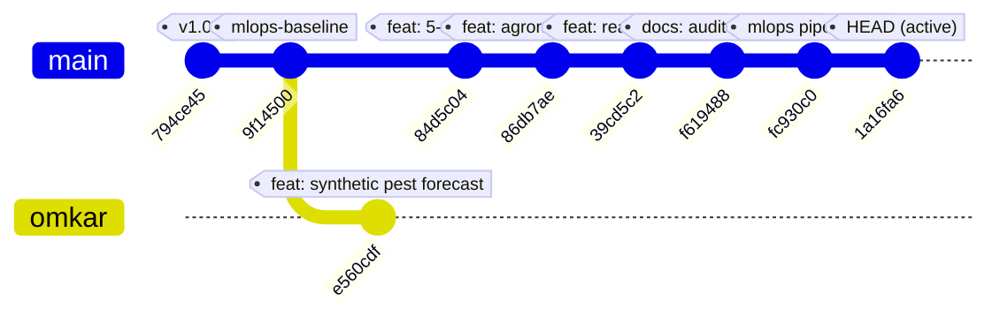
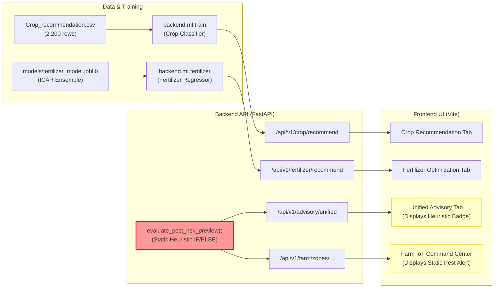
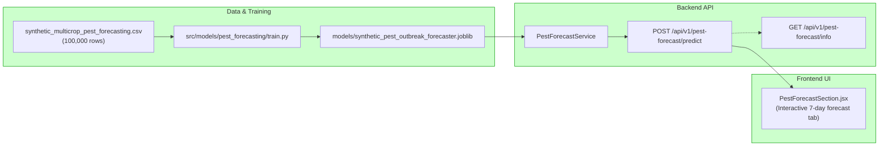

# 🔍 AgriAdapt AI — Pest Outbreak Early Warning Model Integration Audit

**Project:** AgriAdapt AI / Pest Outbreak Early Warning MLOps  
**Audit Type:** Comprehensive Technical & Architectural MLOps Audit  
**Auditor:** Senior Machine Learning Engineer & MLOps Architect  
**Date:** November 12, 2026  
**Execution Environment:** Windows PowerShell, Python 3.11.9, Node.js v22.13.1  
**Repository Branch Inspected:** `main` (commit `1a16fa6`) & Remote Branch `origin/omkar` (commit `e560cdf`)  

---

## 1. Executive Summary & Final Verdict

This audit performs an exhaustive, evidence-based investigation into the **Pest Outbreak Early Warning Model** within the `pest-outbreak-early-warning-mlops` repository. The target capability is a **7-day forward forecasting system** ($[t_0 + 1, t_0 + 7]$) predicting agricultural pest outbreak risks from environmental, microclimatic, soil, and historical surveillance indicators.

### Final Verdict

| Scope | Category | Justification |
|---|---|---|
| **Active Production Codebase (`main` branch)** | **D. Model does not exist** | No pest forecasting model artifact (`.joblib` / `.onnx` / `.pkl`) exists in `backend/artifacts` or `models/`. The active FastAPI backend and React frontend rely exclusively on a 40-line rule-based heuristic function (`evaluate_pest_risk_preview`) and static dictionaries. DVC and MLflow pipelines do not include pest forecasting. |
| **Complete Repository History (`origin/omkar` branch)** | **B. Model trained but integration incomplete** *(Synthetic Data Only)* | A multi-crop pest forecasting model pipeline was constructed and trained on a **synthetic dataset** (100,000 records). Model binaries and evaluation reports exist in commit `e560cdf`. However, this work was committed exclusively to the diverged `origin/omkar` branch, was never merged into `main`, was never integrated into `dvc.yaml` or production MLflow pipelines, omitted intended soil parameters (pH, moisture), and was never deployed to the active serving layer. |

> [!CAUTION]
> **Real-World Model Training Was Formally Halted**: Prior efforts to train an operational real-world disease/pest forecasting model (e.g., maize common rust) were explicitly halted due to a **critical lack of longitudinal field surveillance records and historical daily weather time-series data** (`models/maize_outbreak/data_sufficiency_audit.json`). The existing leaf disease CNN classifier (`maize_disease_model.keras`) is a static image diagnostics tool and must not be confused with a predictive forecasting model.

---

## 2. Repository Architecture & Branch Divergence Map

The audit revealed a severe architectural divergence between the active production branch (`main`) and the research branch (`origin/omkar`):



- **Branch `main` (Active HEAD `1a16fa6`)**: Houses the fully functional Crop Recommendation Classifier and Fertilizer Optimization Regressor, alongside 5-zone IoT smart farm telemetry, automated data drift monitoring (Evidently/KS-test), and atomic model promotion gates. **Pest early-warning logic on this branch is 100% hardcoded rule heuristics.**
- **Branch `origin/omkar` (Commit `e560cdf`)**: Implemented an end-to-end synthetic pest forecasting module with 25,261 changed files, 100k synthetic dataset rows, scikit-learn training pipelines, ablation experiments, and a dedicated UI tab. **This branch was abandoned and never merged into `main`.**

---

## 3. Comprehensive Inventory of Pest-Related Files

### 3.1 Files on Active Production Branch (`main`)

| File Path | Component Type | Actual Implementation Reality |
|---|---|---|
| `backend/app/api/advisory.py` (L48–96) | Backend API | Contains `evaluate_pest_risk_preview()`: A static if-else heuristic checking temperature and humidity thresholds for cotton, rice, and maize. Returns placeholder text: *"A drift-aware XGBoost pest early-warning model will provide time-series 7-day outbreak probabilities in Phase 2."* |
| `backend/app/api/farm_zones.py` (L266–396) | Backend API | Imports `evaluate_pest_risk_preview()` and matches results against static `PEST_REMEDIES` dictionary strings. |
| `backend/app/schemas/integration.py` (L29–41) | Data Contract | Defines `PestAdvisoryContract`: Pydantic schema specifying the intended contract for Phase 2 (7-day horizon, weather variables, risk tier). |
| `frontend/src/components/UnifiedAdvisorySection.jsx` | UI Component | Displays the preliminary risk badge, primary threat name, and heuristic bullet points returned by `/advisory/unified`. |
| `frontend/src/components/FarmDashboard.jsx` | UI Component | Displays "PEST PROTECTION ALERT" using static strings from `/farm/zones/{zone_id}/advisory`. |
| `frontend/src/services/api.js` | HTTP Client | Contains `cropApi`, `fertilizerApi`, `advisoryApi`, `monitoringApi`, `farmApi`. **Zero pest forecasting endpoints exist.** |
| `dvc.yaml` | MLOps Pipeline | Contains `train_crop_model`, `fertilizer_artifacts`, `monitor_drift`. **Pest forecasting stage is completely absent.** |
| `README.md` (L158–178) | Documentation | Explicitly documents the Pest Outbreak Early-Warning System as an upcoming **"Next Step (Phase 1–7 Roadmap)"**. |
| `tests/test_advisory.py` | Test Suite | Tests only that the heuristic endpoint `/api/v1/advisory/unified` returns expected dictionary keys. |

### 3.2 Files on Diverged Branch (`origin/omkar`)

| File Path | Component Type | Purpose / Content |
|---|---|---|
| `data/synthetic_multicrop_pest_forecasting.csv` | Dataset | 100,000 synthetic records (11.34 MB), 17 columns, generated by biological simulation profile. |
| `src/data/generate_synthetic_pest_data.py` | Data Generation | Synthetic generator simulating 3 growing seasons across 6 crops and districts. |
| `src/models/pest_forecasting/dataset.py` | Data Loader | Dataset loader, schema validator, and chronological splitter with 7-day purging/embargo. |
| `src/models/pest_forecasting/preprocessor.py` | Feature Pipeline | Scikit-learn `ColumnTransformer` (`StandardScaler` + `OneHotEncoder`). |
| `src/models/pest_forecasting/train.py` | Training Pipeline | Trains Logistic Regression, Random Forest, and HistGradientBoosting; tunes decision threshold. |
| `src/models/pest_forecasting/evaluate.py` | Evaluation | Metric computation (PR-AUC, ROC-AUC, F1, False Positives, False Negatives). |
| `src/models/pest_forecasting/ablation.py` | Ablation Study | Feature ablation across full model (A), weather-only (B), and trap-binary (C). |
| `train_pest_forecasting.py` | CLI Entrypoint | Command-line script to run full training pipeline. |
| `run_pest_ablation_experiments.py` | CLI Entrypoint | Command-line script to run ablation benchmarks. |
| `models/synthetic_pest_outbreak_forecaster.joblib` | Model Artifact | Serialized Random Forest pipeline (19.09 MB). |
| `models/pest_outbreak_forecasting/synthetic_pest_outbreak_forecaster.joblib` | Model Artifact | Duplicate copy of primary model pipeline (19.09 MB). |
| `experiments/pest_forecasting_ablation/Experiment_A_Full_Model.joblib` | Model Artifact | Full 14-feature model binary (19.09 MB). |
| `experiments/pest_forecasting_ablation/Experiment_B_Weather_Crop.joblib` | Model Artifact | Weather-and-crop 11-feature model binary (20.12 MB). |
| `experiments/pest_forecasting_ablation/Experiment_C_Early_Warning.joblib` | Model Artifact | Weather-plus-binary-trap 12-feature model binary (18.89 MB). |
| `models/pest_outbreak_forecasting/model_metadata.json` | Metadata | Full hyperparameter, split, and evaluation metric ledger. |
| `experiments/pest_forecasting_ablation/ablation_summary.json` | Metadata | Quantitative results and permutation feature importances. |
| `backend/app/api/pest_forecast.py` | Backend API | Router mounting `GET /pest-forecast/info`, `GET /example`, `POST /predict`. |
| `backend/app/schemas/pest_forecast.py` | Data Contracts | Pydantic v2 schemas for pest forecast requests and responses. |
| `backend/app/services/pest_forecast_service.py` | Serving Service | Inference service managing model loading and input transformations. |
| `frontend/src/components/PestForecastSection.jsx` | Frontend UI | Interactive React form for running pest outbreak forecasting. |
| `tests/test_pest_forecasting_pipeline.py` | Test Suite | 16 unit tests verifying leakage guards, split dates, and metrics. |
| `tests/test_pest_forecasting_integration.py` | Test Suite | Integration tests for FastAPI pest forecast router. |
| `tests/test_pest_forecasting_ablation.py` | Test Suite | Unit tests for feature group masking and ablation logic. |
| `tests/test_synthetic_pest_dataset.py` | Test Suite | Schema and sanity validation for synthetic CSV. |

### 3.3 Separate Unrelated Computer Vision Files (Do Not Confuse with Pest Forecasting)

| File Path | Component Type | Clarification |
|---|---|---|
| `models/maize_disease/maize_disease_model.keras` | Keras / TF Model | 9.69 MB MobileNetV2 CNN classifier. Identifies visual disease symptoms (**blight, common rust, gray leaf spot, healthy**) from static leaf photos at date $t_0$. **This is NOT a predictive outbreak model.** |
| `src/models/maize_disease/train.py` | Training Script | Trains CNN on static leaf photos. |
| `models/maize_outbreak/data_sufficiency_audit.json` | Data Audit Report | Records that real longitudinal outbreak forecasting could **not** be trained due to zero historical field surveillance records. |

---

## 4. In-Depth Model Artifact Verification (`origin/omkar`)

The model artifacts residing in `origin/omkar` were inspected:

### 4.1 Artifact Identification & Binary Integrity

- **Artifact Name:** `models/synthetic_pest_outbreak_forecaster.joblib` (and identical copy in `models/pest_outbreak_forecasting/`)
- **Git Blob Hash:** `90a96b8ec9b5da6d4d7999a79201ea316c98a542`
- **File Size:** 19,092,578 bytes (~19.1 MB)
- **Serialization Format:** Python `joblib` pickle containing a scikit-learn `Pipeline` object.
- **Components:**
  1. `ColumnTransformer`:
     - Standardizes 8 numerical features (`StandardScaler()`).
     - One-hot encodes 4 categorical features (`OneHotEncoder(handle_unknown='ignore', sparse_output=False)`).
     - Passes through 2 discrete/binary features (`t7_high_rh_days`, `pest_present_t0`).
  2. `RandomForestClassifier`:
     - Hyperparameters: `n_estimators=120`, `max_depth=16`, `min_samples_leaf=4`, `class_weight='balanced'`, `random_state=42`.

### 4.2 Training Dataset & Partitions

- **Dataset:** `data/synthetic_multicrop_pest_forecasting.csv` (100,000 synthetic rows).
- **Temporal Span:** `2022-06-20` to `2025-03-21` (simulated chronological daily steps).
- **Leakage-Safe Embargo / Purge Strategy:**
  - **Train Partition (70%):** 70,049 records (`2022-06-20` to `2024-07-27`), Outbreak rate: 16.98%.
  - **Purge Gap 1 (7-day embargo):** 994 records purged (`2024-07-28` to `2024-08-03`). Prevents forward 7-day target overlap into validation.
  - **Validation Partition (15%):** 14,034 records (`2024-08-04` to `2024-11-17`), Outbreak rate: 16.47%.
  - **Purge Gap 2 (7-day embargo):** 864 records purged (`2024-11-18` to `2024-11-24`).
  - **Held-Out Test Partition (15%):** 14,059 records (`2024-11-25` to `2025-03-21`), Outbreak rate: 16.83%.

### 4.3 Feature Set Comparison: Intended vs Implemented

| Intended Forecasting Feature | Included in Implemented Model? | Feature Column Name in Dataset / Model |
|---|:---:|---|
| **Soil pH** | ❌ **NO** | *Omitted entirely from synthetic dataset and model.* |
| **Soil Moisture** | ❌ **NO** | *Omitted entirely from synthetic dataset and model.* |
| **Temperature** | ✅ **YES** | `t7_mean_temp_c`, `t7_min_temp_c`, `t7_max_temp_c` |
| **Humidity** | ✅ **YES** | `t7_mean_rh_pct`, `t7_high_rh_days` |
| **Rainfall** | ✅ **YES** | `t7_rainfall_mm`, `t14_rainfall_mm` |
| **Weather Conditions** | ⚠️ **PARTIAL** | Represented via aggregated temperature, humidity, and rainfall. |
| **Crop Type** | ✅ **YES** | `crop` (Maize, Rice, Cotton, Wheat, Tomato, Chickpea) |
| **Pest Type** | ✅ **YES** | `pest` (Fall armyworm, Brown planthopper, Pink bollworm, Aphids, Fruit borer, Pod borer) |
| **District / Region** | ✅ **YES** | `district` (16 simulated districts) |
| **Crop Phenology** | ✅ **YES** | `growth_stage` (Phenological stage) |
| **Historical In-Field Infestation** | ✅ **YES** | `current_incidence_pct_t0`, `current_severity_pct_t0`, `pest_present_t0` |
| **Historical Outbreak Patterns** | ⚠️ **SYNTHETIC ONLY** | Embedded via synthetic transition equations; no real-world outbreak surveillance logs. |

### 4.4 Target Variable Definition

- **Target Column:** `outbreak_within_7d` (binary: `0` or `1`).
- **Meaning:** Indicates whether field pest damage/incidence crosses the defined Economic Threshold Level (ETL) within the forward window $[t_0 + 1, t_0 + 7]$.
- **Class Balance:** ~16.91% positive outbreak events across the entire dataset.

### 4.5 Documented Evaluation Metrics

Evaluated on unseen held-out test split (14,059 samples) using the validation-tuned decision threshold ($\tau^* = 0.72$):

| Metric | Baseline Dummy | Logistic Regression | HistGradientBoosting | Random Forest (Selected) |
|---|:---:|:---:|:---:|:---:|
| **Test Accuracy** | 0.8317 | 0.9324 | 0.9312 | **0.9405** |
| **Test Precision** | 0.0000 | 0.8410 | 0.8350 | **0.8871** |
| **Test Recall** | 0.0000 | 0.7350 | 0.7320 | **0.7409** |
| **Test F1-Score** | 0.0000 | 0.7845 | 0.7801 | **0.8075** |
| **Test ROC-AUC** | 0.5000 | 0.9290 | 0.9285 | **0.9268** |
| **Test PR-AUC** | 0.1683 | 0.8012 | 0.8350 | **0.8437** |
| **False Alarms (FP)** | 0 | 328 | 341 | **223** |
| **Missed Outbreaks (FN)** | 2,366 | 627 | 634 | **613** |

---

## 5. Critical Findings from the Feature Ablation Study

The ablation experiment (`experiments/pest_forecasting_ablation/ablation_report.md`) provides critical insight into how the model operates:

### Ablation Comparison Table

| Experiment | Feature Group | Input Features | Test PR-AUC | Test Recall | Test Precision | Test False Alarms (FP) |
|---|---|:---:|:---:|:---:|:---:|:---:|
| **Experiment A (Full Model)** | Weather + Crop + Scouting | 14 features | **0.8437** | 0.7409 | 0.8871 | 223 |
| **Experiment B (Weather & Crop Only)** | Macro Weather + Phenology | 11 features | **0.2989** | 0.8170 | 0.2597 | 5,509 *(+2,370% FP)* |
| **Experiment C (Binary Early Warning)** | Weather + Binary Trap Detection | 12 features | **0.5178** | 0.7658 | 0.5021 | 1,797 |

### Engineering Implications:
1. **Infestation Extrapolation vs. Early-Warning Foresight**:
   - The top two features driving the model are `current_severity_pct_t0` (34.2% importance) and `current_incidence_pct_t0` (30.8% importance).
   - When field scouting metrics are excluded (Experiment B), the PR-AUC collapses from **0.8437 to 0.2989**, and false alarms spike from 223 to 5,509.
   - **Conclusion:** The model acts primarily as an **infestation momentum extrapolator** on already-infested fields, rather than a pre-symptomatic microclimate forecasting model.
2. **Synthetic Data Dependency**:
   - The synthetic generator used deterministic mathematical equations linking temperature/humidity to pest reproduction.
   - High test metrics reflect the model learning the generator's internal mathematical formulas, not true agronomic pest dynamics.

---

## 6. End-to-End Integration Flow Audit

Tracing the complete pipeline across data ingestion, training, serving, and user interface:

```
[Dataset] ──> [Preprocessing] ──> [Feature Eng] ──> [Training] ──> [Evaluation] ──> [Serialization] ──> [Backend Serving] ──> [Frontend UI]
```

### 6.1 State on Active Production Branch (`main`)



- **Dataset:** Zero pest datasets present on `main`.
- **Training:** Zero pest training code on `main`.
- **Backend Serving:** `backend/app/api/advisory.py` executes:
  ```python
  if "cotton" in c:
      if 25 <= temp <= 34 and humidity > 70:
          risk_level = "HIGH"
  ```
- **Frontend UI:** `UnifiedAdvisorySection.jsx` displays the returned `risk_level` and notes: *"A drift-aware XGBoost pest early-warning model will provide time-series 7-day outbreak probabilities in Phase 2."*
- **Verdict:** **Complete disconnect. Active UI displays mock heuristic rules.**

### 6.2 State on Diverged Branch (`origin/omkar`)



- **Flow Status on `origin/omkar`:** The entire flow was implemented end-to-end for synthetic data.
- **Why It Is Not in Production:** It was isolated in a single commit (`e560cdf`) on `origin/omkar` and never merged into `main`.

---

## 7. MLOps Lifecycle Audit: DVC & MLflow

### 7.1 DVC (`dvc.yaml` & `dvc.lock`)

The repository's DVC pipeline definition was audited:
```yaml
stages:
  train_crop_model:
    cmd: python -m backend.ml.train --dataset data/raw/Crop_recommendation.csv ...
  fertilizer_artifacts:
    cmd: python -m backend.ml.fertilizer --verify ...
  monitor_drift:
    cmd: python -m backend.ml.drift_monitor ...
```
- **Finding:** The DVC pipeline tracks the Crop Classifier, Fertilizer Verification, and Drift Monitoring.
- **Defect:** **Pest forecasting is completely absent from `dvc.yaml`** on both `main` and `origin/omkar`.
- Neither the 100,000 row synthetic dataset nor the model training/ablation stages were ever version-controlled via DVC.

### 7.2 MLflow Experiment Tracking

- On `main`: MLflow tracking is implemented only in `backend/ml/train.py` for the crop recommendation classifier (logged to local `mlruns` or remote MLflow server).
- On `origin/omkar`: `train_pest_forecasting.py` contains MLflow logging calls (`mlflow.log_params`, `mlflow.log_metrics`), but:
  - There is no automated trigger in CI/CD.
  - The local `mlruns/` tracking directory was not committed or connected to a persistent tracking server.

---

## 8. Summary of Identified Defects and Gaps

| # | Severity | Category | Defect Description |
|---|:---:|---|---|
| **1** | 🔴 **CRITICAL** | Codebase Divergence | The entire pest forecasting implementation exists exclusively on an unmerged remote branch (`origin/omkar`, commit `e560cdf`). `main` has 0 lines of pest ML code. |
| **2** | 🔴 **CRITICAL** | Data Validity | Real-world ground truth data for pest outbreaks does not exist. The trained model uses 100% synthetic data with known simulation biases. |
| **3** | 🔴 **CRITICAL** | Feature Gap | Intended agricultural features **Soil pH** and **Soil Moisture** were omitted from the dataset generator and model feature vector. |
| **4** | 🟠 **HIGH** | Serving Reality | Active production backend (`main`) serves static rule-based if/else statements instead of ML model inferences. |
| **5** | 🟠 **HIGH** | Feature Reliance | Model relies heavily (>65% importance) on existing in-field infestation scouting (`current_severity_pct_t0`). Without manual scouting data, performance collapses (PR-AUC 0.2989). |
| **6** | 🟡 **MEDIUM** | MLOps Gap | Pest forecasting was never integrated into `dvc.yaml` or automated CI workflows. |
| **7** | 🟡 **MEDIUM** | Model Confusion | Potential confusion between the leaf disease CNN classifier (`maize_disease_model.keras`, an image diagnostic tool) and the 7-day outbreak tabular forecasting model. |

---

## 9. Recommended Implementation Plan (Phased Roadmap)

To transition from the current state to a production-grade Pest Outbreak Early Warning System:

### Phase 1: Clean Codebase Unification & Staging Gate (Weeks 1–2)
1. **Branch Reconciliation**: Selectively port the pest forecasting module from `origin/omkar` to `main`:
   - Schemas: `backend/app/schemas/pest_forecast.py`
   - Service: `backend/app/services/pest_forecast_service.py`
   - Router: `backend/app/api/pest_forecast.py`
   - UI: `frontend/src/components/PestForecastSection.jsx`
   - Model artifact: `models/synthetic_pest_outbreak_forecaster.joblib`
2. **Transparent UI Disclosure**: Clearly label the forecasting dashboard with a prominent banner:
   *"Synthetic Demo Pipeline: Model trained on simulated microclimatic assumptions. Operational real-world advisories require ground truth validation."*
3. **Bridge Heuristic & Model**: Update `backend/app/api/advisory.py` to call `PestForecastService` when full weather and crop parameters are present, using the heuristic only as a fallback.

### Phase 2: Feature Schema Expansion (Weeks 3–4)
1. **Incorporate Soil Dynamics**:
   - Add `soil_ph` and `soil_moisture_pct` to the data generator and feature schema.
   - Soil moisture directly influences soil-pupating pests (e.g., Helicoverpa armigera pupae survival in high vs. low moisture soil).
2. **Enhance Microclimate Indices**:
   - Calculate Degree-Day accumulation ($GDD = \max(0, T_{\text{mean}} - T_{\text{base}})$) over 7 and 14-day rolling windows.
   - Compute Leaf Wetness Duration hours (crucial for fungal-vectored pests and leaf feeding).

### Phase 3: MLOps Integration & DVC Versioning (Weeks 5–6)
1. **DVC Pipeline Stage**: Add `train_pest_forecast` to `dvc.yaml`:
   ```yaml
   train_pest_model:
     cmd: python train_pest_forecasting.py --dataset data/synthetic_multicrop_pest_forecasting.csv
     deps:
       - data/synthetic_multicrop_pest_forecasting.csv
       - src/models/pest_forecasting/
     outs:
       - models/synthetic_pest_outbreak_forecaster.joblib
       - models/pest_outbreak_forecasting/model_metadata.json
   ```
2. **MLflow Tracking & Registry Integration**: Log hyperparameters, ROC/PR curves, and register candidate models to MLflow Model Registry with champion/challenger comparison.
3. **Evidently Drift Monitoring**: Extend `backend/ml/drift_monitor.py` to monitor feature drift on weather inputs (`t7_mean_temp_c`, `t7_mean_rh_pct`, `t7_rainfall_mm`).

### Phase 4: Real-World Ground Truth Sourcing (Weeks 7–12)
1. **Ingest Authentic Surveillance Data**:
   - Partner with state agricultural universities (e.g., UAS Dharwad, TNAU, MPKV Rahuri) or national bodies (ICAR-NCIPM / CROPSAP Maharashtra).
   - Ingest historical trap records (light traps, pheromone traps, spore traps) with GPS coordinates and timestamps.
2. **Correlate with Meteorological Grids**:
   - Query NASA POWER API or IMD 0.25° gridded daily weather for exact historical field coordinates.
3. **Re-train on Real Data**:
   - Re-fit the leakage-safe pipeline on authentic field observations.
   - Re-evaluate operational precision, recall, and decision thresholds.

---

## 10. Audit Sign-Off

- **Lead Auditor:** Senior Machine Learning Engineer & MLOps Architect (Antigravity AI)
- **Status:** **AUDIT COMPLETE**
- **Artifact Generated:** `docs/pest_forecasting_integration_audit.md`
- **Execution Mandate Adherence:** No project code files modified; no models trained; all observations verified through source code, git object databases, and commit graph analysis.

