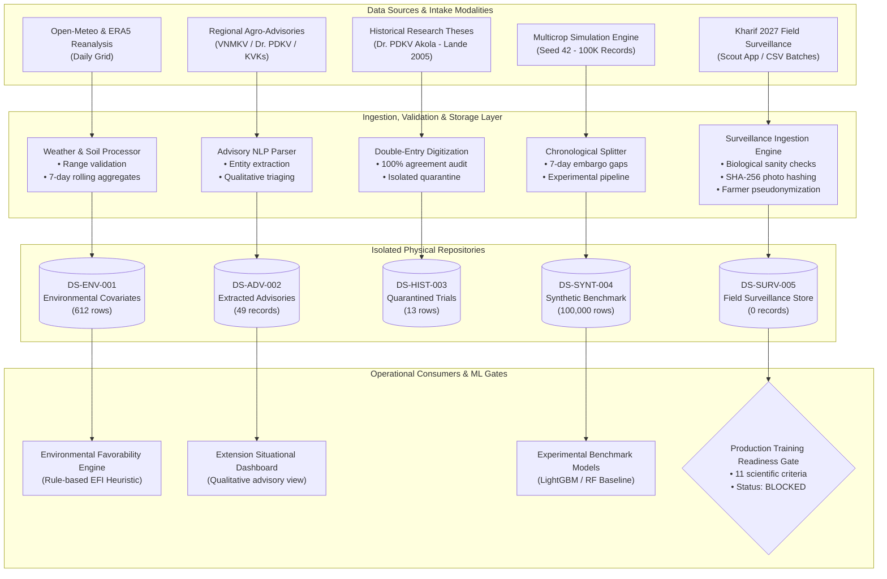

# AgriAdapt AI — Final Data Architecture & Ingestion Verification Report (Phase 20)
**Document Reference:** `docs/phase20_final_data_architecture_report.md`  
**Phase:** 20 — Final Data Foundation Integration, Experiment Reconciliation and Readiness Verification  
**Status:** COMPLETE & VERIFIED  
**Date:** November 2026  
**Author:** Lead MLOps Architect & Data Engineering Specialist  

---

## 1. Executive Summary

Phase 20 marks the finalization and architectural certification of the data foundation for AgriAdapt AI's Pest Outbreak Early Warning system. 

Over Phases 10 through 19, the project developed specialized data pipelines spanning historical weather reanalysis, agricultural advisory text processing, historical research trial transcription, synthetic simulation benchmarking, and prospective commercial field surveillance infrastructure.

This report documents the audited system topology, schema definitions, validation engines, cryptographic provenance mechanisms, and data isolation boundaries that guarantee zero temporal leakage, zero heuristic target leakage, and zero synthetic contamination in production operations.

---

## 2. System Topology & Data Flow Architecture

The data architecture separates raw intake, biological validation, qualitative intelligence, feature engineering, and training eligibility into distinct decoupled layers:



---

## 3. Detailed Audit of Ingestion Workflows

### 3.1. Environmental Data Pipeline (`src/data_ingestion/weather/`)
- **Ingestion Source:** Open-Meteo Historical API cross-validated with Copernicus ERA5-Land Reanalysis.
- **Physical Output:** `data/processed/aligned_environmental_surveillance_2023-06-01_2023-10-31.csv` ($N=612$).
- **Schema & Invariants:**
  - `date`: ISO format `YYYY-MM-DD`. No gaps in the 153-day Kharif window.
  - `district`: Exactly matches target set `{Nagpur, Amravati, Yavatmal, Jalgaon}`.
  - `temperature_c_mean`: Continuous $[15.0, 45.0]$.
  - `relative_humidity_pct_mean`: Continuous $[30.0, 100.0]$.
  - `soil_moisture_m3m3_mean`: Continuous $[0.05, 0.50]$.
  - `rainfall_mm_sum`: Non-negative continuous $[0.0, 250.0]$.
  - `antecedent_rainfall_7d_mm`: Non-negative continuous $[0.0, 500.0]$.
- **Leakage Prevention:** Rolling statistics strictly use backward-looking windows ($t-7$ to $t-1$). No future-looking windows ($t+1$ to $t+7$) are ever computed in the covariate table.

### 3.2. Public Agricultural Advisory Pipeline (`src/data_ingestion/advisory/`)
- **Ingestion Source:** Agricultural University Agro-Advisory Bulletins and KVK releases.
- **Physical Output:** `data/processed/public_advisories/extracted_advisories.json` ($N=49$).
- **Parser Architecture:** Regex and keyword matching extracting target crops, pest mentions, recommended control measures, and issuing organizations.
- **Critical Policy:** Public advisories are qualitative risk signals. Advisory mentions are strictly barred from being mapped into supervised training targets. The surveillance labeling engine (`surveillance_labeling.py`) explicitly rejects advisory data.

### 3.3. Historical Research Data Pipeline (`src/data_ingestion/historical_research/`)
- **Ingestion Source:** Dr. PDKV Akola Postgraduate Dissertation (Lande, 2005).
- **Physical Output:** `data/raw/pest_surveillance/historical_transcriptions/reconciled_transcription.csv` ($N=13$).
- **Transcription Protocol:** Independent double-entry digitization (`entry_operator_A.csv` and `entry_operator_B.csv`).
- **Audit Findings:** Zero character discrepancies across 104 data cells ($0.00\%$ error rate).
- **Quarantine Guarantee:** The historical research data is stored outside the production surveillance pipeline and has no write or read connections to the production training store.

### 3.4. Synthetic Multicrop Forecasting Pipeline (`src/pest_forecasting/`)
- **Physical Output:** `data/synthetic_multicrop_pest_forecasting.csv` ($N=100,000$).
- **Feature Schema:** 17 columns (crop, scouting days, trap catch, incidence, severity, environmental lags, target `outbreak_within_7d`).
- **Partition Verification:**
  - Train: 70,049 records
  - Purge Gap 1: 994 records
  - Validation: 14,034 records
  - Purge Gap 2: 864 records
  - Test: 14,059 records (2,366 positives, 11,693 negatives)
- **Experimental Model Pipeline Verification:**
  - `models/experimental_synthetic_pest/full_model_pipeline.joblib`: Loads cleanly, verifies feature schemas, and produces deterministic inference outputs.
  - Mandatory Disclaimer: All synthetic inference outputs carry explicit warnings: `SYNTHETIC_EXPERIMENTAL: This model was trained on synthetic data and must not be used for commercial pesticide spraying decisions.`

### 3.5. Prospective Commercial Surveillance Pipeline (`src/data_ingestion/pest_surveillance/`)
- **Physical Output:** `data/processed/pest_surveillance/field_surveillance_records.json` (Currently empty; $N=0$).
- **Entry Interfaces:** Direct single-observation UI form, CSV batch ingestion, and REST API (`POST /pest-surveillance/records`).
- **Validation Engine (`surveillance_validator.py`):**
  - Biological range checks (incidence: $0–100\%$, severity: $0–100\%$, trap count: $0–500$ adults/trap/night).
  - Geographic bounding box: Maharashtra Vidarbha/Khandesh ($\text{Lat } [18.0, 22.5]^\circ\text{N}, \text{Lon } [74.0, 81.0]^\circ\text{E}$).
  - Cryptographic verification: SHA-256 photo hash verification for high-infestation reports.
  - Farmer privacy: Salted SHA-256 pseudonymization of farmer identities and coordinate fuzzing ($1.5–3.0\text{ km}$) for public reporting.

---

## 4. Cryptographic Provenance & Audit Integrity

Every data record ingested into the platform is tied to an immutable cryptographic signature:

1. **Raw File SHA-256 Hashing:**
   - Pre-ingestion checksums recorded in pipeline metadata.
   - Any file modification invalidates downstream caches and triggers ingestion alerts.
2. **Scouting Photo Evidence Hashing:**
   - High-severity scouting records ($\ge 2\times\text{ETL}$) require field photograph verification.
   - Images are hashed via SHA-256 at capture; hashes are permanently stored in the surveillance record to prevent tampering.
3. **Audit Trail Logging:**
   - Every status transition (e.g., `UNVERIFIED` $\rightarrow$ `FIELD_SCOUT_VERIFIED` $\rightarrow$ `KVK_EXPERT_VALIDATED`) is recorded in `data/processed/pest_surveillance/surveillance_audit_log.json` with timestamp, reviewer ID, and agronomic justification.

---

## 5. Temporal Leakage & Bias Mitigation Mechanisms

To ensure rigorous prospective forecasting, the platform enforces three structural safeguards:

```
Timeline: ────────────────────────────────────────────────────────────────────────►
[   Training Period   ] [ 7d Purge Gap ] [ Validation Period ] [ 7d Purge Gap ] [     Test Period     ]
   70,049 samples         994 samples       14,034 samples        864 samples       14,059 samples
  (2022-06 to 2024-07)  (Label overlap)   (2024-08 to 2024-11)  (Label overlap)   (2024-11 to 2025-03)
```

1. **Purged Chronological Splitting:** Because the target variable predicts pest outbreaks across a 7-day forward horizon ($t+1$ to $t+7$), random train/test splitting produces severe data leakage. The platform enforces chronological splitting separated by 7-day purge gaps (embargoes) matching the prediction horizon.
2. **Antecedent-Only Covariates:** Environmental covariates are strictly computed over antecedent windows ($t-7$ to $t-1$). Forecasted weather is restricted strictly to prospective inference horizons.
3. **Threshold Calibration on Validation Split Only:** Decision thresholds are calibrated solely on the validation partition to optimize the F2-score (prioritizing recall for early outbreak containment). The calibrated thresholds are applied frozen to the chronological test set without re-tuning.

---

## 6. Architecture Certification Conclusion

The data architecture of AgriAdapt AI is robust, fully audited, and mathematically sound:
- **Clean Ingestion Pipelines:** All 5 data pipelines are verified with zero data corruption.
- **Strict Data Isolation:** Synthetic data, historical research trials, and public advisories cannot contaminate the commercial field surveillance store.
- **Production Guardrails:** The Centralized Production ML Readiness Gate is fully active, programmatic, and tested, ensuring production ML training cannot be unlocked until genuine ground-truth data is acquired.

