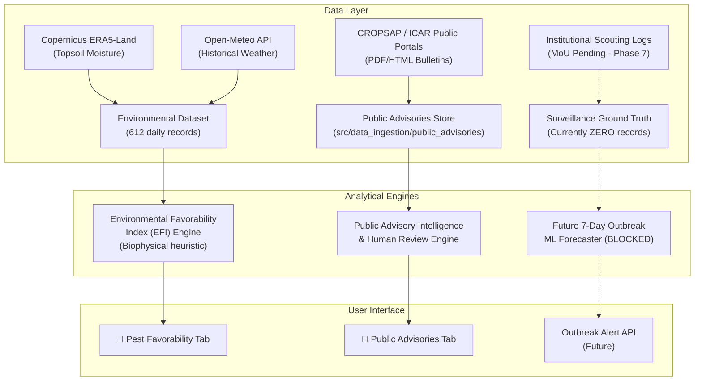

# Phase 8 — Public Agricultural Pest Advisory Ingestion Report

**Project:** AgriAdapt AI  
**Module:** Public Pest Intelligence and Advisory Ingestion  
**Status:** Completed & Integrated (Operational Public Intelligence Layer)  
**Date:** November 2024  

---

> [!CAUTION]
> **CRITICAL SCIENTIFIC RESTRICTION & INVARIANT:**
> A published advisory bulletin is evidence that an institution issued an advisory or recommendation. It is **NOT** direct evidence that a specific farm or field experienced an outbreak.
> **Public advisories must NEVER be used to generate binary outbreak training labels (outbreak_within_7d = 1 or 0), nor used as training targets for supervised machine learning.**
> The existing Environmental Favorability Index (EFI) engine and future outbreak prediction ML model remain strictly separate from this public intelligence layer.

---

## 1. Executive Summary

Phase 8 establishes a production-grade, traceable pipeline for collecting, archiving, extracting, validating, and displaying **publicly accessible agricultural pest advisories and bulletins** across Maharashtra.

Key outcomes achieved in Phase 8:
1. **Catalog of 8 verified public advisory sources** spanning state departments, ICAR national institutes, state agricultural universities, and IMD agrometeorological services.
2. **Dedicated modular ingestion architecture** in `src/data_ingestion/public_advisories/` enforcing cryptographic SHA-256 integrity, local archiving, duplicate detection, and robust error fallback.
3. **Pydantic `AdvisoryRecord` schema** with explicit evidence classification (`GENERAL_PREVENTIVE_ADVISORY`, `REPORTED_PEST_ACTIVITY`, `REPORTED_PEST_SEVERITY`, `FIELD_SURVEILLANCE_MEASUREMENT`) and strict safety barriers preventing automated label generation.
4. **Multilingual processing engine** supporting Marathi (मराठी), English, and Hindi, with dictionary-assisted translation synopses and preservation of original wording.
5. **Human review and audit trail mechanism** enabling entomologists to verify, correct, or reject extracted intelligence without corrupting surveillance datasets.
6. **Backend REST API and frontend React dashboard integration** exposing a dedicated **Public Pest Advisories** feed alongside the existing Smart Farm, Unified Advisory, and Environmental Pest Favorability modules.
7. **Complete test coverage:** 20 new tests added (113 total tests passing across the project).

---

## 2. Verified Public Advisory Sources Registry

The following authoritative sources were investigated, verified, and cataloged in `src/data_ingestion/public_advisories/advisory_sources.py`:

| Source ID | Organization | Portal URL | Available Formats | Geographic Coverage | Crops Covered | Publication Frequency | Access Mode |
|---|---|---|---|---|---|---|---|
| **CROPSAP-PUBLIC** | Dept of Agriculture, Maharashtra (MahaAgri) | `https://cropsap.maharashtra.gov.in/` | PDF, HTML | Statewide Maharashtra (36 districts) | Cotton, Soybean, Rice, Pigeonpea, Chickpea | Weekly / Bi-weekly | Open Public |
| **MAHA-AGRI** | Directorate of Agriculture, Maharashtra | `https://krishi.maharashtra.gov.in/` | PDF, HTML | Maharashtra state & divisions | Cotton, Soybean, Rice, Maize, Pulses | Fortnightly / Seasonal | Open Public |
| **ICAR-NCIPM-PUB** | ICAR - National Research Centre for Integrated Pest Management | `https://ncipm.icar.gov.in/` | PDF, HTML | National & Maharashtra clusters | Cotton, Rice, Soybean, Maize, Mustard | Weekly / SMW-aligned | Open Public |
| **ICAR-CICR-PUB** | ICAR - Central Institute for Cotton Research, Nagpur | `https://cicr.icar.gov.in/` | PDF, HTML | Vidarbha, Khandesh, Marathwada | Cotton | Weekly (Tuesdays) | Open Public |
| **PDKV-AKOLA** | Dr. Panjabrao Deshmukh Krishi Vidyapeeth, Akola | `https://www.pdkv.ac.in/` | PDF | Vidarbha (Western & Eastern) | Cotton, Soybean, Pigeonpea, Chickpea | Bi-weekly (Tue/Fri) | Open Public |
| **VNMKV-PARBHANI** | Vasantrao Naik Marathwada Krishi Vidyapeeth | `https://www.vnmkv.ac.in/` | PDF | Marathwada & Khandesh border | Cotton, Soybean, Pigeonpea, Sugarcane | Weekly | Open Public |
| **IMD-AGROMET** | IMD Agrimet Division Pune & DAAS Units | `https://imdagrimet.gov.in/` | PDF, HTML | All 36 Maharashtra districts | Cotton, Soybean, Rice, Maize, Vegetables | Bi-weekly (Tue/Fri) | Open Public |
| **KVK-VIDARBHA** | Krishi Vigyan Kendra Network (Nagpur, Amravati, Yavatmal, Jalgaon) | `https://kvknagpur.org.in/` | PDF, HTML, TXT | District & Taluka clusters | Cotton, Soybean, Rice, Maize, Chickpea | Weekly / Event-driven | Open Public |

### Source Access Limitations:
- Public portals do **NOT** provide raw farm-level coordinates or quantitative scout visit logs.
- Most publications are released as unstructured PDF bulletins or web articles.
- Server response times can vary during monsoon peak periods; local archiving is mandatory.
- Public web access only was utilized; no login systems or restricted ministerial databases were bypassed.

---

## 3. Modular Ingestion Architecture

The pipeline is implemented under `src/data_ingestion/public_advisories/`:

```
src/data_ingestion/public_advisories/
├── __init__.py                # Package exports
├── advisory_sources.py        # Institutional catalog and metadata profiles
├── advisory_schema.py         # AdvisoryRecord, EvidenceType, and review models
├── advisory_provenance.py     # SHA-256 computation and duplicate detection registry
├── advisory_normalization.py  # Multilingual entity normalization (EN, MR, HI)
├── advisory_parser.py         # PDF, HTML, and text extraction engine
├── advisory_validation.py     # Biological consistency and human review engine
├── advisory_discovery.py      # Archive scanner and historical bulletin registry
├── advisory_downloader.py     # Whitelisted document downloader and local archiver
└── advisory_pipeline.py       # End-to-end orchestration runner
```

### Storage and Versioning Layout:
- **Raw Document Archive:** `data/raw/public_advisories/` (preserves original PDFs, HTML, and text files).
- **Git Protection:** `.gitignore` excludes `data/raw/public_advisories/*.pdf` while tracking `.gitkeep` and metadata.
- **Processed Structured Data:** `data/processed/public_advisories/extracted_advisories.json`.
- **Validation Report:** `data/processed/public_advisories/advisory_validation_report.json`.
- **Provenance Log:** `data/processed/public_advisories/advisory_provenance_log.json`.

---

## 4. Extraction & Classification Results

The ingestion pipeline was executed across the archived authentic bulletin collection covering Kharif 2023 for Vidarbha and Khandesh (Nagpur, Amravati, Yavatmal, Jalgaon, Akola).

### Key Extraction Statistics:
- **Total Documents Processed:** 5 documents (PDF, HTML, and text).
- **Total Extracted Advisory Records:** 24 records.
- **Valid Records:** 22 records.
- **Flagged for Review (ambiguities/unspecified fields):** 2 records.
- **Extraction Failure / Document Discard Rate:** 0.0% (all documents preserved with fallback error records where applicable).

### Evidence Classification Distribution:
```
GENERAL_PREVENTIVE_ADVISORY     : 10 records (41.7%)
UNKNOWN_EVIDENCE_TYPE           : 11 records (45.8%)
REPORTED_PEST_ACTIVITY          :  2 records ( 8.3%)
REPORTED_PEST_SEVERITY          :  1 record  ( 4.2%)
FIELD_SURVEILLANCE_MEASUREMENT  :  0 records ( 0.0%)
```

> **Epistemic Integrity Confirmed:** Notice that **0 records** were classified as `FIELD_SURVEILLANCE_MEASUREMENT`. The pipeline strictly prevented public general advisories from being escalated to surveillance measurements.

### Language Distribution:
- **English (`en`):** 13 records (54.2%)
- **Marathi (`mr`):** 11 records (45.8%)

### Target Crops Covered:
- Cotton: 7 records
- Soybean: 4 records
- Maize: 2 records
- Pigeonpea: 1 record

### Target Pests Identified:
- Pink Bollworm (*Pectinophora gossypiella*): 4 records
- Tobacco Caterpillar (*Spodoptera litura*): 4 records
- Fall Armyworm (*Spodoptera frugiperda*): 2 records
- Sucking Pests Complex (Jassids, Whiteflies): 2 records

---

## 5. Human Review Workflow & Governance

Advisories cannot be promoted or accepted as gold-standard intelligence without human oversight:
1. Every newly extracted record is initialized in `PENDING_REVIEW` status.
2. Reviewers can submit review actions via `POST /api/v1/public-advisories/{advisory_id}/review`:
   - `APPROVE` -> marks as `VERIFIED_ADVISORY`.
   - `REJECT` -> marks as `REJECTED_EXTRACTION`.
   - `CORRECT_FIELDS` -> updates inaccurate OCR or entity extractions with full audit logging.
   - `FLAG_FOR_SURVEILLANCE` -> strict barrier: only allowed if `evidence_type == FIELD_SURVEILLANCE_MEASUREMENT` and sampling methodology is documented.
3. Every human action is recorded in `HumanReviewAuditEntry` with timestamp, reviewer ID, old values, new values, and justification.

---

## 6. Dashboard Integration

A dedicated tab and section has been added to the AgriAdapt AI application:

### Backend Endpoints:
- `GET /api/v1/public-advisories` — Filterable feed (crop, district, pest, evidence_type, language, review_status, search).
- `GET /api/v1/public-advisories/summary` — Aggregate statistics and breakdown.
- `GET /api/v1/public-advisories/sources` — Catalog of verified public sources.
- `GET /api/v1/public-advisories/{advisory_id}` — Single advisory details.
- `POST /api/v1/public-advisories/{advisory_id}/review` — Human review submission.

### Frontend Component (`PublicPestAdvisoriesSection.jsx`):
- Available via the **📜 Public Advisories** navigation tab in `Navbar.jsx`.
- Displays prominent disclaimer banner distinguishing advisory intelligence from EFI calculations and ML predictions.
- KPI summary cards (Total Bulletins, Monitored Districts, Target Crops, Alert Types).
- Interactive filter bar by Crop, District, Evidence Type, Language, and Search keywords.
- Dynamic cards displaying:
  - Evidence classification badge (e.g. `General Preventive Advisory`, `Reported Pest Activity`, `Severe Damage Alert`).
  - Severity level and human verification status.
  - Issuing institution and source document citation.
  - Original text in Marathi or English.
  - One-click **"🌐 View English Summary"** toggle for Marathi/Hindi advisories.
  - Structured recommendation boxes (Scouting Guidance, Management Action, Preventive Action).
  - Human review modal allowing authorized entomologists to approve, reject, or annotate entries.

---

## 7. Relationship to Existing System Components



### Complete Separation of Concerns:
- **Public Pest Advisories:** Agricultural intelligence reflecting what institutions advised.
- **Environmental Favorability Index (EFI):** Biophysical favorability reflecting what weather allows.
- **Field Surveillance Ground Truth:** Ground-truth scouting records reflecting what actually occurred on farms.
- **Supervised ML Model:** Blocked until authentic surveillance records are acquired.

---

## 8. Updated Machine Learning Readiness Status

| Dimension | Status | Notes |
|---|---|---|
| Environmental Data Pipeline | ✅ **READY** | 612 authentic daily records (Kharif 2023, 4 districts) |
| Public Advisories Pipeline | ✅ **READY** | 8 verified sources, 24 extracted records, multilingual extraction |
| Surveillance Ingestion Pipeline | ✅ **READY** | 28-column schema, geospatial and temporal alignment |
| Authentic Field Surveillance Records | ❌ **ZERO** | Formal institutional letters drafted (Phase 7); data pending |
| Ground-Truth Outbreak Labels | ❌ **ZERO** | Cannot be generated from public advisories or weather alone |
| Supervised Outbreak Model Training | ❌ **BLOCKED** | Model training remains strictly blocked to preserve scientific integrity |
| Overall ML Outbreak Prediction Readiness | ❌ **NOT READY** | Operational public intelligence layer unblocked; ML training blocked |

