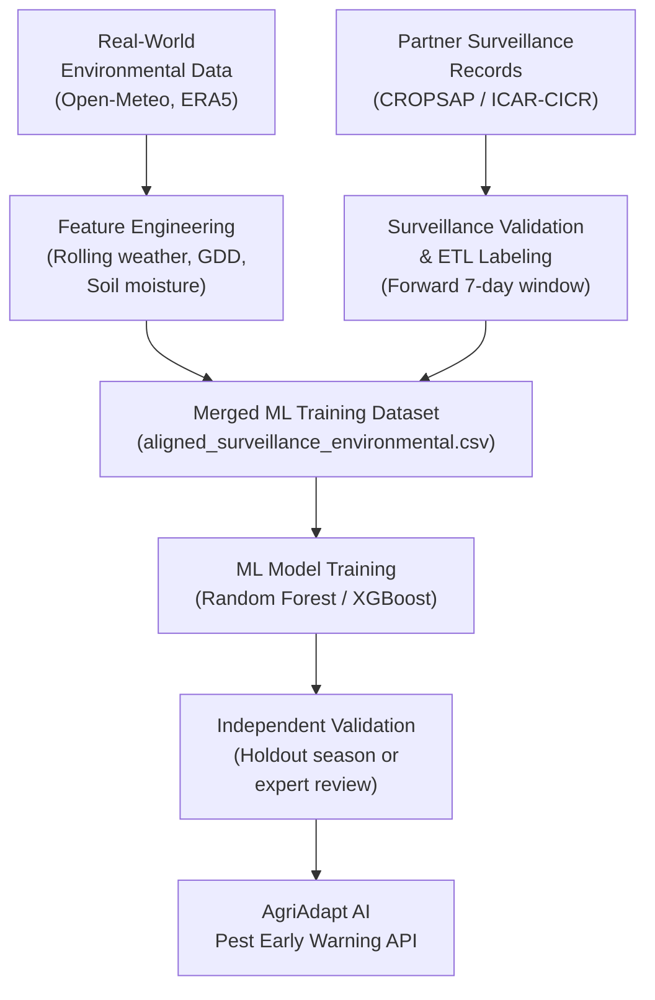

# Research Collaboration Proposal

**Project:** AgriAdapt AI — Pest Outbreak Early Warning MLOps System  
**Module:** Machine Learning–Based Pest Forecasting for Maharashtra Smallholder Agriculture  
**Version:** DRAFT — Requires institutional review and supervisor approval before submission  
**Date:** [INSERT DATE]

---

> [!IMPORTANT]
> This is a draft research collaboration proposal template. All placeholders in brackets must be completed by the student researcher. This document does not constitute an institutional commitment without authorised signatures.

---

## 1. Executive Summary

We propose a research collaboration between **[INSERT INSTITUTION]** and **[INSERT PARTNER INSTITUTION, e.g., ICAR-CICR Nagpur / CROPSAP Maharashtra]** to develop a scientifically defensible, machine learning–based pest outbreak early warning system for the Vidarbha and Khandesh regions of Maharashtra.

The proposed collaboration involves:

1. **Data sharing** — Access to authenticated field-level pest surveillance records collected by the partner institution.
2. **Scientific validation** — Expert entomological review of economic threshold parameters and model outputs.
3. **Joint publication** — Co-authorship opportunities in peer-reviewed journals and agricultural informatics venues.

---

## 2. Problem Statement

Maharashtra's smallholder farmers — particularly cotton, soybean, and rice growers in Vidarbha and Khandesh — incur annual crop losses estimated in billions of rupees due to pest outbreaks, specifically from:

- **Pink Bollworm** (*Pectinophora gossypiella*) in cotton
- **American Bollworm** (*Helicoverpa armigera*) in cotton
- **Tobacco Caterpillar** (*Spodoptera litura*) in soybean
- **Brown Planthopper** (*Nilaparvata lugens*) in rice
- **Fall Armyworm** (*Spodoptera frugiperda*) in maize

Traditional pest management relies on:
- **Calendar-based prophylactic spraying** — resource-intensive, environmentally harmful, and frequently mistimed.
- **Reactive scouting** — interventions occur after economic threshold breaches, reducing effectiveness.
- **Informal farmer networks** — lack of systematic, real-time surveillance.

A data-driven early warning system capable of issuing **seven-day advance alerts** would enable targeted, pre-emptive interventions at substantially lower pesticide input, with direct benefits for farmer income, environmental health, and food security.

---

## 3. Research Objectives

| # | Objective |
|---|---|
| O1 | Develop a validated two-tier pest outbreak early warning architecture combining environmental favorability assessment (Tier 1) with field-surveillance–calibrated ML forecasting (Tier 2). |
| O2 | Acquire and curate authentic, institutionally verified pest surveillance records for Vidarbha and Khandesh for at least three Kharif seasons. |
| O3 | Train, validate, and independently evaluate a seven-day binary outbreak prediction model using Random Forest or Gradient Boosted Trees on the authentic dataset. |
| O4 | Validate model predictions against independent field observations or expert entomological assessment. |
| O5 | Publish findings in a peer-reviewed agricultural informatics or plant protection journal. |

---

## 4. Current Implementation Status

### 4.1 Environmental Data Infrastructure ✅

The following have been implemented and are operational:

| Component | Status |
|---|---|
| Weather data ingestion (Open-Meteo API) — Nagpur, Amravati, Yavatmal, Jalgaon | ✅ Operational |
| ERA5-Land topsoil moisture ingestion (Copernicus CDS) | ✅ Operational |
| 612 daily environmental records covering Kharif 2023 (Jun–Oct 2023) | ✅ Available |
| Causal rolling weather features and Growing Degree Days (GDD) | ✅ Computed |
| DVC-managed data versioning pipeline | ✅ Operational |

### 4.2 Surveillance Pipeline Infrastructure ✅

| Component | Status |
|---|---|
| 28-column validated surveillance data schema (Pydantic) | ✅ Ready |
| SHA-256 provenance and data integrity verification | ✅ Implemented |
| Maharashtra geographic bounds validation | ✅ Implemented |
| Crop-pest biological compatibility registry | ✅ Implemented |
| Geospatial alignment with environmental grid (60 km threshold) | ✅ Implemented |
| IMD Standard Meteorological Week (SMW) temporal alignment | ✅ Implemented |
| Forward 7-day outbreak labeling (zero lookahead leakage) | ✅ Implemented |
| Economic Threshold Level (ETL) registry (5 crop-pest pairs) | ✅ Implemented |
| Test suite — 93 tests passing | ✅ Verified |

### 4.3 Experimental Environmental Risk Engine ✅

An Environmental Favorability Index (EFI) engine is operational, providing **experimental pre-scouting risk estimates** based on meteorological triggers for 5 crop-pest profiles. This is explicitly labelled as an experimental tool, NOT a calibrated ML model.

### 4.4 Supervised ML Model — BLOCKED ❌

Supervised seven-day outbreak prediction training remains blocked pending acquisition of **authentic verified pest surveillance labels** from partner institutions.

---

## 5. Proposed Methodology

### 5.1 Data Integration Protocol

1. Partner surveillance records are ingested using the validated 28-column schema.
2. Each field observation is spatially matched to the closest environmental grid station (≤60 km).
3. Antecedent 7-day causal weather features [T-6, T] are aligned without lookahead leakage.
4. Forward outbreak labels are generated using official ETL thresholds.
5. Only records with verified positive or verified negative labels (NOT unobserved windows) enter the ML training set.

### 5.2 Minimum Training Dataset Requirements

| Requirement | Minimum | Preferred |
|---|---|---|
| Scouting visits (total records) | 2,500 | 5,000+ |
| Positive outbreak events (label = 1) | 250 | 500+ |
| Consecutive Kharif seasons | 2 | 3 |
| Districts covered | 4 | 7+ |

> **Note:** These requirements have been estimated conservatively for a district-level binary classifier with 10–15 input features. Final dataset adequacy will be re-evaluated based on positive event prevalence and spatial autocorrelation analysis.

---

## 6. Partner Contributions and Researcher Contributions

| Contribution | Partner Institution | Research Team |
|---|---|---|
| Field-level pest surveillance records | ✅ Primary provider | — |
| ETL validation and entomological review | ✅ Expert advisors | Implementors |
| Environmental data acquisition | — | ✅ Completed |
| Data pipeline and ML engineering | — | ✅ Completed |
| Model training, evaluation, interpretation | — | ✅ Lead |
| Manuscript preparation | Joint | Joint |
| Attribution and acknowledgement | Credited | Credited |

---

## 7. Proposed Publication and Attribution

| Output Type | Venue (Target) | Expected Timeline |
|---|---|---|
| Research Paper | Journal of Plant Protection Research / Indian Phytopathology / Computers & Electronics in Agriculture | 12–18 months post data access |
| Conference Poster | ICAR annual science conference / ASABE | 6–12 months |
| Open-source code | GitHub (code only; no raw data) | Upon publication |

**Attribution in all outputs:**

> "Pest surveillance ground-truth data provided by [PARTNER INSTITUTION] under a data-sharing agreement with [RESEARCHER INSTITUTION]. The authors gratefully acknowledge [PARTNER INSTITUTION] for entomological expertise and institutional support."

---

## 8. Data Governance Summary

| Item | Commitment |
|---|---|
| Data ownership | Remains with partner institution |
| Permitted use | Academic research only; non-commercial |
| Storage | Local encrypted drive; not in public repositories |
| GPS/farm identity | Aggregated to village/taluka level; not disclosed |
| Retention | Secure deletion or return at project end |
| NDA | Willing to execute in partner's preferred format |

---

## 9. Contact and Next Steps

**Principal Researcher:**  
[INSERT STUDENT FULL NAME]  
[INSERT INSTITUTION, DEPARTMENT]  
[INSERT EMAIL] | [INSERT PHONE]

**Academic Supervisor:**  
[INSERT SUPERVISOR NAME AND DESIGNATION]  
[INSERT INSTITUTION]  
[INSERT SUPERVISOR EMAIL]

**Proposed Next Step:** A virtual or in-person meeting with the [PARTNER]'s Director of Research / Head of Crop Protection Division to discuss data-sharing modalities, MoU terms, and timelines.

---

> [!NOTE]
> This proposal is submitted in good faith as an academic collaboration request. No data request has been granted or promised. All data-sharing terms are subject to formal MoU negotiation and institutional legal review.

