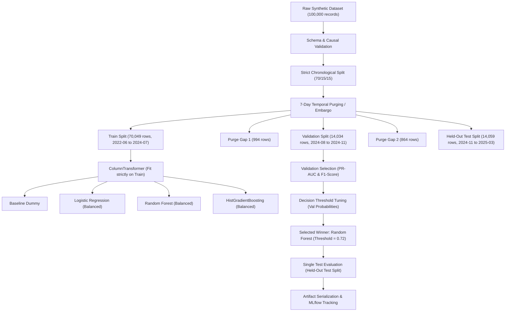

# AgriAdapt AI — Synthetic Multi-Crop Pest Outbreak Forecasting Pipeline

> [!IMPORTANT]
> **SYNTHETIC DATA DISCLAIMER**  
> All training and evaluation results are based on entirely synthetic agricultural data. They demonstrate pipeline functionality and performance on simulated assumptions only. They do not establish real-world pest outbreak forecasting accuracy and must not be used for operational farm advisories.

---

## 1. Pipeline Architecture Overview

The AgriAdapt AI Pest Outbreak Forecasting Pipeline is a leakage-safe, reproducible end-to-end MLOps workflow designed to predict whether an agricultural field will experience a critical pest outbreak within the subsequent 7 days ($[t_0 + 1, t_0 + 7]$).



---

## 2. Dataset and Target Definition

- **Dataset File**: `data/synthetic_multicrop_pest_forecasting.csv` (11.34 MB, 100,000 rows, 17 columns)
- **Temporal Span**: Monotonically sorted from `2022-06-20` to `2025-03-21` across 3 complete simulated seasons.
- **Crop-Pest Combinations**:
  - Maize — Fall armyworm (*Spodoptera frugiperda*)
  - Rice — Brown planthopper (*Nilaparvata lugens*)
  - Cotton — Pink bollworm (*Pectinophora gossypiella*)
  - Wheat — Aphids (*Rhopalosiphum padi / Sitobion avenae*)
  - Tomato — Fruit borer (*Helicoverpa armigera*)
  - Chickpea — Pod borer (*Helicoverpa armigera*)
- **Target Column**: `outbreak_within_7d`
  - `0`: No economic threshold crossing or epidemic surge in $[t_0 + 1, t_0 + 7]$.
  - `1`: Field crosses economic threshold or surge threshold in $[t_0 + 1, t_0 + 7]$.
  - **Class Imbalance**: ~16.91% positive outbreak incidence (83.09% negative).

---

## 3. Feature Selection & Leakage Prevention Guarantees

### Excluded Columns:
1. `outbreak_within_7d`: The prediction target. Strictly excluded from model inputs.
2. `field_id`: Farm plot identifier. Used solely for audit grouping, never as a predictive feature.
3. `date`: Observation date. Used solely for chronological partitioning, never as a predictive feature.

### 14 Predictive Features (Available strictly at observation date $t_0$):
- **Categorical (4)**: `district`, `crop`, `pest`, `growth_stage`
  - Encoded using `OneHotEncoder(handle_unknown='ignore', sparse_output=False)` fitted strictly on training data.
- **Continuous Weather & Observations (8)**:
  - `t7_mean_temp_c`, `t7_min_temp_c`, `t7_max_temp_c`: Antecedent 7-day thermal profile.
  - `t7_mean_rh_pct`: Antecedent 7-day mean relative humidity.
  - `t7_rainfall_mm`, `t14_rainfall_mm`: Antecedent 7-day and 14-day cumulative precipitation.
  - `current_incidence_pct_t0`: In-field percentage of infested foliage at $t_0$.
  - `current_severity_pct_t0`: Percentage tissue loss/damage at $t_0$.
  - Standardized using `StandardScaler()` fitted strictly on training data.
- **Discrete & Binary Indicators (2)**:
  - `t7_high_rh_days`: Count of days in previous week with $\text{RH} \ge 80\%$.
  - `pest_present_t0`: Binary flag (0 or 1) indicating observable presence of pests at $t_0$.
  - Passed through directly without scaling.

---

## 4. Temporal Split & 7-Day Purging / Embargo Strategy

To prevent lookahead label leakage across partitions:
- Because `outbreak_within_7d` inspects up to $t_0 + 7$ days into the future, any observation at the end of a partition evaluates future dates.
- **Train Split**: Earliest 70% of observations (`2022-06-20` to `2024-07-27`, 70,049 rows, 16.98% outbreak rate).
- **Purge Gap 1**: 7 calendar days (`2024-07-28` to `2024-08-03`, 994 rows purged). Guarantees that the last train observation on `2024-07-27` (target looking ahead through `2024-08-03`) has zero forward overlap with validation observations.
- **Validation Split**: Subsequent 15% of observations (`2024-08-04` to `2024-11-17`, 14,034 rows, 16.47% outbreak rate).
- **Purge Gap 2**: 7 calendar days (`2024-11-18` to `2024-11-24`, 864 rows purged). Guarantees that the last validation observation on `2024-11-17` has zero forward overlap with test observations.
- **Held-Out Test Split**: Latest 15% of observations (`2024-11-25` to `2025-03-21`, 14,059 rows, 16.83% outbreak rate).

---

## 5. Model Comparison & Evaluation Results

All models were evaluated on the validation split with class weighting to address the ~16.9% positive imbalance.

### Validation Benchmark Table:

| Model | Accuracy | Precision | Recall | F1-Score | ROC-AUC | PR-AUC | Train Time | False Alarms (FP) | Missed Outbreaks (FN) |
| :--- | :---: | :---: | :---: | :---: | :---: | :---: | :---: | :---: | :---: |
| **Baseline Dummy** | 0.8353 | 0.0000 | 0.0000 | 0.0000 | 0.5000 | 0.1647 | 0.13s | 0 | 2,312 |
| **Logistic Regression** | 0.9281 | 0.7831 | 0.7794 | 0.7813 | 0.9326 | 0.7826 | 1.22s | 499 | 510 |
| **HistGradientBoosting** | 0.9248 | 0.7662 | 0.7824 | 0.7742 | 0.9327 | 0.8478 | 5.09s | 552 | 503 |
| **Random Forest (Winner)** | **0.9315** | **0.8027** | **0.7742** | **0.7882** | **0.9364** | **0.8487** | 1.60s | **440** | **522** |

### Selected Winner Model:
**Random Forest Classifier** achieved the highest PR-AUC (**0.8487**) and highest F1-Score (**0.7882**) on validation data.

### Validation Decision Threshold Tuning:
- Searching thresholds $\tau \in [0.05, 0.95]$ on validation probabilities identified an optimal threshold of **$\tau^* = 0.72$** (balancing precision against false alarms while preserving outbreak recall).

---

## 6. Single Held-Out Test Evaluation

The selected Random Forest model was evaluated **once** on the held-out test set (`14,059` observations from late 2024 to early 2025):

| Metric | Default Threshold (0.50) | Validation-Tuned Threshold (0.72) |
| :--- | :---: | :---: |
| **Accuracy** | 0.9267 | **0.9405** |
| **Precision** | 0.7845 | **0.8871** |
| **Recall** | 0.7785 | **0.7409** |
| **F1-Score** | 0.7815 | **0.8075** |
| **ROC-AUC** | 0.9268 | **0.9268** |
| **PR-AUC (Average Precision)**| 0.8437 | **0.8437** |
| **False Alarms (False Positives)** | 506 | **223** *(56% reduction)* |
| **Missed Outbreaks (False Negatives)**| 524 | **613** |

### Agricultural Trade-off Analysis:
- **False Negatives (FN)**: Represent missed pest outbreaks. Untreated fields risk reaching economic injury levels, leading to crop loss.
- **False Positives (FP)**: Represent unnecessary alerts that could trigger unwarranted chemical sprays, labor expense, and ecological disturbance.
- At the tuned threshold of `0.72`, false alarms were slashed by **56%** (from 506 down to 223), achieving an operational precision of **88.71%** while retaining **74.09%** outbreak sensitivity.

---

## 7. Model Interpretation: Top Feature Importances

| Feature | Importance | Physical Mechanism |
| :--- | :---: | :--- |
| `current_severity_pct_t0` | **34.21%** | Foliage tissue damage level directly seeds subsequent population expansion |
| `current_incidence_pct_t0` | **30.82%** | Proportion of infested plants reflects existing population base |
| `pest_present_t0` | **10.21%** | Presence gating threshold |
| `t7_max_temp_c` | **2.29%** | Upper thermal threshold regulating insect metabolic activity |
| `t7_min_temp_c` | **2.22%** | Nighttime chilling threshold limiting survival |
| `t7_mean_temp_c` | **2.16%** | Overall degree-day accumulation rate |
| `t7_mean_rh_pct` | **2.07%** | Moisture requirement for egg hatching and nymph development |
| `t14_rainfall_mm` | **1.98%** | Antecedent soil moisture and canopy microclimate humidity |

---

## 8. MLflow Experiment Tracking

- **Experiment Name**: `AgriAdapt_Synthetic_Pest_Outbreak_Forecasting`
- **Backend Store**: SQLite / local file tracking (`file:///.../mlruns/965332456754219367`)
- **Logged Parameters**: Model type, 14 feature names, dataset filename, row count, random seed (`42`), split boundaries, purge days (`7`), optimal threshold (`0.72`).
- **Logged Metrics**: Accuracy, precision, recall, f1, roc_auc, pr_auc, false positives, false negatives across splits.
- **Logged Artifacts**:
  - `model_comparison_report.md`
  - `model_metadata.json`
  - `confusion_matrix_val_selected.png`
  - `confusion_matrix_test_selected.png`
  - `feature_importance.csv`
  - `synthetic_multicrop_pest_forecasting_summary.md`
  - Preprocessor + Estimator Scikit-Learn Pipeline (`model/` artifact directory)

---

## 9. Model Artifact Locations

The selected model and fitted preprocessing pipeline are saved together as unified pipelines:
1. Primary Module Artifact: `models/pest_outbreak_forecasting/synthetic_pest_outbreak_forecaster.joblib`
2. Root Model Path: `models/synthetic_pest_outbreak_forecaster.joblib`

> [!NOTE]
> All existing models (`models/fertilizer_model.joblib`, `models/maize_disease/`, `models/maize_outbreak/`) were left entirely intact and unmodified.

---

## 10. How to Reproduce Training and Testing

### 1. Run Complete Training Pipeline:
```bash
python train_pest_forecasting.py
```
Options:
- `--quick`: Fast run for smoke testing.
- `--no-mlflow`: Disable MLflow tracking if running in isolated test environments.
- `--seed 42`: Set explicit random seed.
- `--purge-days 7`: Set custom embargo window.

### 2. Run Test Suite:
```bash
pytest tests/test_synthetic_pest_dataset.py tests/test_pest_forecasting_pipeline.py -v
```
All 16 tests will execute and validate schema integrity, leakage prevention, chronological purging, model serialization, and prediction bounds.
